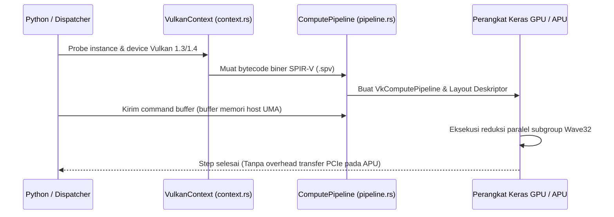

# `luminav-vulkan`: Pipeline Komputasi Vulkan Ash & Wave32 UMA

`luminav-vulkan` menghadirkan akselerasi komputasi GPU lintas platform menggunakan compute shader standar Vulkan 1.3 / 1.4, menargetkan GPU non-NVIDIA (AMD Radeon, Intel Arc/Iris, Apple via MoltenVK) dan arsitektur memori terpadu APU (Unified Memory Architecture / UMA).

[English Version (README.md)](README.md)

---

## 1. Arsitektur Komputasi Vulkan

Pipeline komputasi diorkestrasi menggunakan binding Rust `ash` tanpa dependensi runtime eksternal yang berat:

---

## 2. Koleksi Shader Komputasi SPIR-V (`shaders/`)

Crate ini mengompilasi shader komputasi GLSL menjadi bytecode biner SPIR-V:

1. **`tdclm_single_pass.comp`**: Kernel TD-CLM mode single-buffer yang mengeksekusi kompensasi selisih gradien temporal dalam satu lintasan dispatch.
2. **`dual_fused_single_pass.comp`**: Compute shader CLM mode dual-buffer yang menggabungkan pembaruan momen dan penghitungan batas EMA.
3. **`diff_sum.comp`**: Kernel reduksi paralel untuk menjumlahkan divergensi gradien di seluruh lane subgroup.
4. **`post_step_ema.comp`**: Penghalusan post-step koefisien cautious dan batas manifold secara asinkron.

---

## 3. Reduksi Subgroup Wave32 & Akses Memori Zero-Copy UMA

### 3.1 Subgroup Wave32 / Wave64
- Memanfaatkan ekstensi Vulkan `VK_KHR_shader_subgroup_basic` dan `subgroup_arithmetic`.
- Melakukan reduksi intra-warp instan dengan fungsi intrinsik `subgroupAdd()` dan `subgroupMin()`, menghindari hambatan sinkronisasi shared memory konvensional.

### 3.2 Pemetaan Buffer Unified Memory Architecture (UMA)
Pada APU modern (seperti AMD Ryzen dengan grafis Radeon 780M/890M atau Intel Core Ultra):
- Memori host dialokasikan dengan flag `VK_MEMORY_PROPERTY_HOST_VISIBLE_BIT | VK_MEMORY_PROPERTY_HOST_COHERENT_BIT`.
- Compute core GPU membaca dan mengubah data memori host secara langsung tanpa staging copy melintasi bus PCIe.
