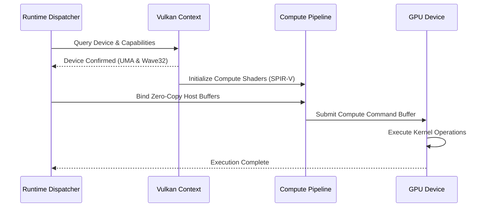

# `luminav-vulkan`: Ash Vulkan Compute Pipeline & Wave32 UMA

`luminav-vulkan` delivers cross-platform GPU compute acceleration via standard Vulkan 1.3 / 1.4 compute shaders, targeting non-NVIDIA GPUs (AMD Radeon, Intel Arc/Iris, Apple via MoltenVK) and Unified Memory Architecture (UMA) APUs.

[Versi Bahasa Indonesia (README.id.md)](README.id.md)

---

## 1. Vulkan Compute Architecture

The compute pipeline is orchestrated via low-level Rust `ash` bindings without large runtime dependencies:

---

## 2. SPIR-V Compute Shaders (`shaders/`)

The crate compiles high-performance GLSL compute shaders into portable SPIR-V bytecode:

1. **`tdclm_single_pass.comp`**: Single-buffer TD-CLM kernel computing temporal difference defect compensation in a single dispatch pass.
2. **`dual_fused_single_pass.comp`**: Dual-buffer CLM compute shader fusing momentum updates and EMA boundary calculations.
3. **`diff_sum.comp`**: Parallel reduction kernel summing gradient divergence across subgroup lanes.
4. **`post_step_ema.comp`**: Asynchronous post-step EMA smoothing for cautious and bounding coefficients.

---

## 3. Wave32 Subgroup Reductions & UMA Zero-Copy

### 3.1 Wave32 / Wave64 Subgroups
- Leverages Vulkan `VK_KHR_shader_subgroup_basic` and `subgroup_arithmetic` extensions.
- Executes fast intra-warp reductions using `subgroupAdd()` and `subgroupMin()`, bypassing shared memory fences where available.

### 3.2 Unified Memory Architecture (UMA) Buffer Mapping
On modern APUs (AMD Ryzen with Radeon 780M/890M or Intel Core Ultra):
- Host memory allocated by CPython or NumPy is directly mapped using `VK_MEMORY_PROPERTY_HOST_VISIBLE_BIT | VK_MEMORY_PROPERTY_HOST_COHERENT_BIT`.
- The GPU compute engine reads and mutates host physical memory without PCIe staging copies, achieving zero-copy throughput.
