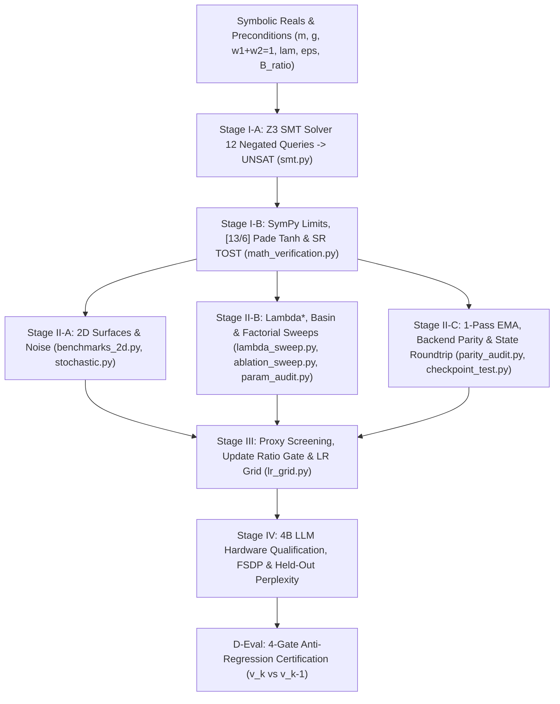

# LSO-Eval: Formal Verification & Benchmarking Suite

The **LSO-Eval Suite** provides formal mathematical verification, Z3 SMT solver invariant proofs, 2D trajectory convergence tests, hyperparameter/ablation sweeps, and IEEE numerical parity audits for the **LuminaV Optimizer** and **LuminaMoon DataLoader** under **PROJECT LUMI**, developed by **Lumina Moon ([@cloverx-id](https://github.com/cloverx-id))** and **Silver Moon ([@cloverxion](https://github.com/cloverxion))**.

---

## LSO-Eval Staged Verification Pipeline



---

## Suite Components

| Component | Path | Stage | Description |
| :--- | :--- | :--- | :--- |
| **Execution Harness** | [`run_all.py`](run_all.py) | Stages I–III | Master evaluation orchestrator executing all 11 verification modules sequentially (`python -m eval`). |
| **Z3 SMT Solver Suite** | [`modules/smt.py`](modules/smt.py) | Stage I-A | Formal Z3 theorem prover checks across 12 negated safety queries (Q1–Q7: div-by-zero, $\|u_t\| < 1$, FP16 subnormal floor, cautious/radial/coordinate bounds, weight decay, descent alignment). |
| **Calculus & Bitwise Audit** | [`modules/math_verification.py`](modules/math_verification.py) | Stage I-B | SymPy large-gradient limit ($u_\infty$), radial $C^0/C^1$ continuity, $[13/6]$ Padé $\tanh$ error, and $200\text{k}$-sample MurmurHash3 stochastic rounding TOST unbiasedness. |
| **Synthetic & Parity Modules** | [`modules/`](modules/__init__.py) | Stage II | `benchmarks_2d.py`, `stochastic.py`, `lambda_sweep.py` ($\lambda^*$ balance), `hyperparam_sweeps.py`, `ablation_sweep.py`, `parity_audit.py` (1-Pass vs 2-Pass EMA), `param_audit.py`, and `checkpoint_test.py`. |
| **LR & Bound Grid** | [`modules/lr_grid.py`](modules/lr_grid.py) | Stage III | Cause-and-effect learning rate grid ($\eta \in [8\times 10^{-4}, 4\times 10^{-2}]$) across coordinate and radial bounding modes. |
| **Standalone Runner** | [`stage1_smt_and_precision.py`](stage1_smt_and_precision.py) | Stages I–III | Self-contained single-file verification script combining Z3 SMT proofs, precision tests, and 2D/grid benchmarks. |
| **Formal Specification** | [`lso_eval_specification.tex`](lso_eval_specification.tex) | Stages I–IV & D-Eval | Complete LSO-Eval v1.0.0 engineering standard, mathematical proofs (Proposition 1), Stage IV 4B LLM benchmarks, and 4-Gate D-Eval specification. |
| **PDF Manuscript** | [`LSO-Eval.pdf`](LSO-Eval.pdf) | All Stages | Compiled formal specification paper and release certification checklist. |

---

## Running Verification

```bash
# Execute full 11-module formal verification and benchmark suite
python -m eval

# Or run standalone Stage 1 SMT & precision script directly
python eval/stage1_smt_and_precision.py
```
