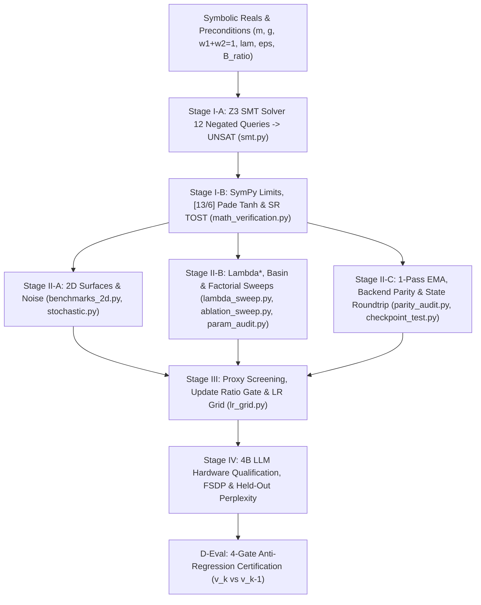

# LSO-Eval: Formal Verification & Benchmarking Suite

The **LSO-Eval Suite** provides formal mathematical verification, Z3 SMT solver invariant proofs, 2D trajectory convergence tests, hyperparameter/ablation sweeps, and IEEE numerical parity audits for the **LuminaV Optimizer** (`v1.5.5` canonical specification) and **LuminaMoon DataLoader** (`v1.0.7`) under **PROJECT LOOMY**, developed by **Silver Moon ([@cloverxion](https://github.com/cloverxion))** and **Lumina Moon ([@cloverx-id](https://github.com/cloverx-id)) contributors**.

---

## LSO-Eval Staged Verification Pipeline



---

## Canonical Mathematical Specification (`v1.5.5`)

1. **Dual-Buffer Convex Lookahead Momentum (`buffer=2` / `CLM`)**:
   - Moments: $m_t = \beta_1 m_{t-1} + (1 - \beta_1) g_t$, $\tilde{m}_t = \beta_1 m_t + (1 - \beta_1) g_t$, $d_t^{(\text{B2})} = g_t - m_t$, and $v_t = \beta_2 v_{t-1} + (1 - \beta_2)(d_t^{(\text{B2})})^2$.
   - Bias-corrected scalars: $\mathrm{bc}_{1,t} = 1 - \beta_1^{t+1}$, $\mathrm{bc}_{2,t} = \max(1 - \beta_2^t, 10^{-15})$, $c_1 = \mathrm{bc}_{1,t}\tau / \sqrt{\mathrm{bc}_{2,t}}$, and $c_2 = \epsilon_{\text{eff}}\mathrm{bc}_{1,t}\tau$.
   - Velocity: $\sigma_t = c_1\sqrt{\max(v_t, 0)} + c_2$ and $u_t^{(\text{B2})} = \tanh_{\mathrm{Pade}}\left(\tilde{m}_t / \max(\sigma_t, 10^{-12})\right) \in (-1, 1)$.

2. **Single-Buffer Triangle-Defect Convex Lookahead Momentum (`buffer=1` / `TD-CLM`)**:
   - Convex weights: $w_1 = \beta_1^2$, $w_2 = 1 - \beta_1^2$ ($w_1 + w_2 = 1$).
   - Lookahead numerator & instantaneous defect: $\tilde{m}_t = w_1 m_{t-1} + w_2 g_t$, $d_t^{(\text{B1})} = g_t - m_{t-1}$.
   - **Triangle Inequality Envelope**:

```math
\mathcal{E}_t = w_1 \lvert m_{t-1} \rvert + w_2 \lvert g_t \rvert + \lambda \lvert d_t^{(\text{B1})} \rvert + \epsilon_{\text{eff}}, \qquad u_t^{(\text{B1})} = \frac{\tilde{m}_t}{\mathcal{E}_t} \in (-1, 1), \qquad m_t = \beta_1 m_{t-1} + (1 - \beta_1) g_t
```

---

## Verified Empirical & Formal Benchmark Summary (`LSO-Eval v1.5.5`)

### 1. Stage I-A & I-B: Z3 SMT Formal Proofs & Symbolic/Bitwise Verification
- **Z3 SMT Solver (12/12 Negated Safety Queries -> `UNSAT`)**:
  - `Q1` TD-CLM Div-Zero ($\mathcal{E}_t \le 0$): `PASSED (UNSAT)`
  - `Q2` TD-CLM Triangle Envelope Bound ($|u_t^{(\text{B1})}| \ge 1.0$): `PASSED (UNSAT)`
  - `Q3` Buffer-2 Sigma Positivity ($\sigma_t \le 0$) & Radial Contraction ($\tanh_{\text{Padé}}(r)/r > 1.0$): `PASSED (UNSAT)`
  - `Q4` FP16 Safe-Zone Floor ($B_i < 1.5\times 10^{-4}$) & Subnormal Breach ($\le 6.1\times 10^{-5}$): `PASSED (UNSAT)`
  - `Q5` Cold-Start Descent Alignment ($u_1 \cdot g_1 < 0$): `PASSED (UNSAT)`
  - `Q6` Decoupled Weight Decay Contraction ($1 - \eta\omega \notin (0, 1]$): `PASSED (UNSAT)`
  - `Q7` Bias Correction Positivity ($1 - \beta_1^{t+1} \le 0 \lor 1 - \beta_2^t \le 0$): `PASSED (UNSAT)`
- **SymPy & Bitwise Verification (9/9 `PASSED`)**:
  - MurmurHash3 32-bit Stochastic Rounding Bias ($200\text{k}$ samples): `Max bias = 3.53e-07` (`PASSED`)
  - Radial Boundary Continuity ($r = 10^{-4}$): `Step jump = 3.33e-09 < eps_fp32` (`PASSED`)
  - TD-CLM Large-Gradient Asymptotic Limit ($\lim_{g\to\infty} u_t^{(\text{B1})} = \frac{w_2}{w_2 + \lambda}$): `0.3878` (`PASSED`)

### 2. Stage II-B: TD-CLM Defect Factor ($\lambda$) Sweep (Proposition 1 Equilibrium $\lambda^* = 0.3008$)

| $\lambda$ | Spike Limit ($u_{\text{spike}}$) | Reversal Limit ($u_{\text{rev}}$) | Steps to $10^{-5}$ | Final Loss | Data-Driven Empirical Behavior Note |
| :--- | :--- | :--- | :--- | :--- | :--- |
| `0.00` | `1.0000` | `0.6200` | `950` | `4.22e-03` | Unregularized B-CLM (hits 1e-5 at 950, rebounds to 4.22e-03) |
| `0.10` | `0.6552` | `0.5167` | `628` | `4.58e-02` | Under-damped spike ceiling (hits 1e-5 at 628, rebounds to 4.58e-02) |
| `0.19` | `0.5000` | `0.4493` | `Max Steps` | `1.91e-02` | Stalled above 1e-5 (final 1.91e-02, resonance w2=lam) |
| **`0.30`** | **`0.3878`** | **`0.3875`** | **`575`** | **`2.06e-02`** | **Spike-reversal equilibrium (u_spk~=u_rev, hits 1e-5 at 575)** |
| `0.50` | `0.2754` | `0.3100` | `571` | `2.24e-04` | Over-damped velocity (hits 1e-5 at 571, rebounds to 2.24e-04) |
| `0.80` | `0.1919` | `0.2385` | `677` | `3.13e-05` | Strong steady-state damping (hits 1e-5 at 677, final 3.13e-05) |
| `1.00` | `0.1597` | `0.2067` | `642` | `8.75e-03` | Over-damped velocity (hits 1e-5 at 642, rebounds to 8.75e-03) |

### 3. Stage III: Fair Learning Rate Grid (15,000 Steps, Noise $\sigma = 0.5$)

| LR ($\eta$) | Bound Type | Buf 1 Steps | Buf 1 Loss | Buf 2 Steps | Buf 2 Loss | Data-Driven Cause & Effect |
| :--- | :--- | :--- | :--- | :--- | :--- | :--- |
| `0.0008` | `radial` | `8882` | `1.28e-04` | `8889` | `4.06e-05` | Baseline parity (\|delta_steps\|=7, final 1.3e-04 / 4.1e-05) |
| `0.0020` | `radial` | `3596` | `4.02e-04` | `3589` | `1.55e-04` | 2.5x faster entry, moderate noise floor (max loss 4.0e-04) |
| `0.0050` | `radial` | `1392` | `1.91e-03` | `1379` | `1.97e-04` | 6.4x faster entry, moderate noise floor (max loss 1.9e-03) |
| `0.010` | `radial` | `674` | `2.24e-03` | `717` | `5.28e-04` | 12.8x faster entry, moderate noise floor (max loss 2.2e-03) |
| `0.020` | `radial` | `444` | `2.40e-01` | `402` | `1.64e-03` | Fast entry (444/402 steps), noise rebound to 2.4e-01 |
| `0.040` | `radial` | `884` | `5.10e-03` | `177` | `1.03e-02` | Fast entry (884/177 steps), noise rebound to 1.0e-02 |
| `0.0008` | `coordinate` | `9030` | `2.01e-05` | `9036` | `1.00e-05` | Baseline parity (\|delta_steps\|=6, final 2.0e-05 / 1.0e-05) |
| `0.0020` | `coordinate` | `3689` | `6.29e-05` | `3601` | `1.32e-04` | 2.5x faster convergence, stable floor (max loss 1.3e-04) |
| `0.0050` | `coordinate` | `1717` | `1.55e-04` | `1433` | `1.77e-04` | 5.8x faster convergence, stable floor (max loss 1.8e-04) |
| `0.010` | `coordinate` | `841` | `1.17e-04` | `838` | `1.40e-04` | 10.8x faster convergence, stable floor (max loss 1.4e-04) |
| `0.020` | `coordinate` | `449` | `2.91e-05` | `461` | `5.94e-05` | 19.9x faster convergence, stable floor (max loss 5.9e-05) |
| `0.040` | `coordinate` | `319` | `1.83e-04` | `409` | `5.72e-05` | 25.2x faster convergence, stable floor (max loss 1.8e-04) |

---

## Suite Components

| Component | Path | Stage | Description |
| :--- | :--- | :--- | :--- |
| **Execution Harness** | [`run_all.py`](run_all.py) | Stages I–III | Master evaluation orchestrator executing all 11 verification modules sequentially (`python -m eval`). |
| **Z3 SMT Solver Suite** | [`modules/smt.py`](modules/smt.py) | Stage I-A | Formal Z3 theorem prover checks across 12 negated safety queries (Q1–Q7: div-by-zero, $\|u_t\| < 1$, FP16 subnormal floor, cautious/radial/coordinate bounds, weight decay, descent alignment). |
| **Calculus & Bitwise Audit** | [`modules/math_verification.py`](modules/math_verification.py) | Stage I-B | SymPy large-gradient limit ($u_\infty$), radial $C^0/C^1$ continuity, $[13/6]$ Padé $\tanh$ error, and $200\text{k}$-sample MurmurHash3 stochastic rounding TOST unbiasedness. |
| **Synthetic & Parity Modules** | [`modules/`](modules/__init__.py) | Stage II | `benchmarks_2d.py`, `stochastic.py`, `lambda_sweep.py` ($\lambda^*$ balance), `hyperparam_sweeps.py`, `ablation_sweep.py`, `parity_audit.py` (1-Pass vs 2-Pass EMA), `param_audit.py`, and `checkpoint_test.py`. |
| **LR & Bound Grid** | [`modules/lr_grid.py`](modules/lr_grid.py) | Stage III | Cause-and-effect learning rate grid ($\eta \in [8\times 10^{-4}, 4\times 10^{-2}]$) across coordinate and radial bounding modes. |
| **Standalone Runner** | [`stage1_smt_and_precision.py`](stage1_smt_and_precision.py) | Stages I–III | Self-contained single-file verification script combining Z3 SMT proofs, precision tests, and 2D/grid benchmarks. |
| **Formal Specification** | [`lso_eval_specification.tex`](lso_eval_specification.tex) | Stages I–IV & D-Eval | Complete LSO-Eval v1.0.0 engineering standard, mathematical proofs (Proposition 1), Stage IV 4B LLM benchmarks, and 4-Gate D-Eval specification. |
| **PDF Manuscript** | [`LSO-Eval.pdf`](LSO-Eval.pdf) | All Stages | Compiled formal specification paper and release certification checklist. |

---

## Running Verification

```bash
# Execute full 11-module formal verification and benchmark suite
python -m eval

# Or run standalone Stage 1 SMT & precision script directly
python eval/stage1_smt_and_precision.py
```
