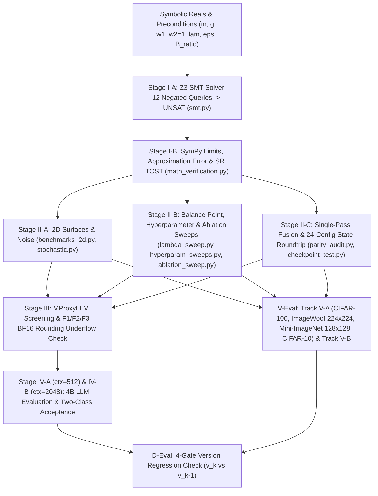

# LSO-Eval: Optimizer Evaluation & Verification

**LSO-Eval** is an algorithm-agnostic mathematical verification, Z3 SMT solver invariant check, 2D trajectory benchmark, hyperparameter/ablation sweep, and evaluation procedure developed by **Silver Moon ([@cloverxion](https://github.com/cloverxion))** and **Lumina Moon ([@cloverx-id](https://github.com/cloverx-id)) contributors**.

---

## LSO-Eval Staged Evaluation Pipeline



---

## Reference Case Mathematical Specification

1. **Dual-Buffer Convex Lookahead Momentum (`buffer=2` / `CLM`)**:
   - Moments:

     $\displaystyle m_t = \beta_1 m _ {t-1} + (1 - \beta_1) g_t, \qquad \tilde{m} _ t = \beta_1 m_t + (1 - \beta_1) g_t$

     $\displaystyle d_t^{(\text{B2})} = g_t - m_t, \qquad v_t = \beta_2 v _ {t-1} + (1 - \beta_2) \left(d_t^{(\text{B2})}\right)^2$

   - Bias-corrected scalars:

     $\displaystyle \hat{\beta} _ {1,t} = 1 - \beta_1^{t+1}, \qquad \hat{\beta} _ {2,t} = \max(1 - \beta_2^t, 10^{-15}), \qquad c_1 = \frac{\hat{\beta} _ {1,t} \tau}{\sqrt{\hat{\beta} _ {2,t}}}, \qquad c_2 = \epsilon _ {\text{eff}} \hat{\beta} _ {1,t} \tau$

   - Velocity:

     $\displaystyle \sigma_t = c_1 \sqrt{\max(v_t, 0)} + c_2, \qquad u_t^{(\text{B2})} = \tanh _ {\text{Pade}}\left(\frac{\tilde{m} _ t}{\max(\sigma_t, 10^{-12})}\right) \in (-1, 1)$

2. **Single-Buffer Triangle-Defect Convex Lookahead Momentum (`buffer=1` / `TD-CLM`)**:
   - Convex weights: $w_1 = \beta_1^2, \quad w_2 = 1 - \beta_1^2 \quad (w_1 + w_2 = 1)$
   - Lookahead numerator & gradient-momentum residual:

     $\displaystyle \tilde{m} _ t = w_1 m _ {t-1} + w_2 g_t, \qquad d_t^{(\text{B1})} = g_t - m _ {t-1}$

   - **Triangle Inequality Envelope**:

     $\displaystyle \mathcal{E} _ t = w_1 |m _ {t-1}| + w_2 |g_t| + \lambda |d_t^{(\text{B1})}| + \epsilon _ {\text{eff}}, \qquad u_t^{(\text{B1})} = \frac{\tilde{m} _ t}{\mathcal{E} _ t} \in (-1, 1), \qquad m_t = \beta_1 m _ {t-1} + (1 - \beta_1) g_t$

---

## V-Eval: Vision Evaluation Matrix (Track V-A & Track V-B)

| Code | Track | Model Backbone | Dataset & Resolution | Default Schedule (`bs=256` / FT) | Contenders Evaluated |
| :--- | :--- | :--- | :--- | :--- | :--- |
| **`V-A1`** | From-Scratch | `ResNet-50` (CIFAR 3x3 stem, ~23.7M) | **CIFAR-100** (`32x32`, 100 cls) | `100 Ep` (`19.5k` steps, `5 Ep` warmup) | 6 Contenders (`LuminaV Buf 1/2`, `AdamW BF16/FP32`, `Lion BF16/FP32`) |
| **`V-A2`** | From-Scratch | `NF-ResNet-50` (Norm-Free, ~25.6M) | **ImageWoof** (`224x224`, 10 cls) | `100 Ep` (`3.7k` steps, `5 Ep` warmup) | 6 Contenders (`LuminaV Buf 1/2`, `AdamW BF16/FP32`, `Lion BF16/FP32`) |
| **`V-A3`** | From-Scratch | `ConvNeXt-V2-Tiny` (~28.6M) | **Mini-ImageNet** (`128x128`, 100 cls) | `100 Ep` (`19.5k` steps, `10 Ep` warmup) | 6 Contenders (`LuminaV Buf 1/2`, `AdamW BF16/FP32`, `Lion BF16/FP32`) |
| **`V-A4`** | From-Scratch | `ViT-Small` (Patch 8x8, ~22.0M) | **Mini-ImageNet** (`128x128`, 100 cls) | `100 Ep` (`19.5k` steps, `10 Ep` warmup) | 6 Contenders (`LuminaV Buf 1/2`, `AdamW BF16/FP32`, `Lion BF16/FP32`) |
| **`V-A5`** | From-Scratch | `SiT-S/2` (Flow Matching, ~33.0M) | **CIFAR-10** (`32x32`, 10 cls) | `100 Ep` (`19.5k` steps, `5 Ep` warmup) | 6 Contenders (`LuminaV Buf 1/2`, `AdamW BF16/FP32`, `Lion BF16/FP32`) |
| **`V-B1`** | Fine-Tuning | `RT-DETR-R18` / `YOLOv11-S` / `FCOS` | **cppe-5 / VOC 2007** (`480x480`) | `25 Ep` (`bs=16`, `2 Ep` warmup) | 6 Contenders (`LuminaV Buf 1/2`, `AdamW BF16/FP32`, `Lion BF16/FP32`) |
| **`V-B2`** | Fine-Tuning | `ViT-Base/16` & `ConvNeXt-Base` | **Oxford-IIIT Pet** (`224x224`, 37 cls) | `20 Ep` (`bs=64`, `2 Ep` warmup) | 6 Contenders (`LuminaV Buf 1/2`, `AdamW BF16/FP32`, `Lion BF16/FP32`) |

---

## Repository Components

| Component | Path | Stage | Description |
| :--- | :--- | :--- | :--- |
| **Execution Harness** | [`run_all.py`](run_all.py) | Stages I–II & V-Eval | Master evaluation runner executing all Stage I, Stage II, and V-Eval CI verification modules (`python -m eval`). |
| **Z3 SMT Solver** | [`modules/smt.py`](modules/smt.py) | Stage I-A | Z3 theorem prover checks across 12 negated safety queries (`Q1–Q7`: div-by-zero, `\|u_t\| < 1`, FP16 subnormal floor, cautious/radial/coordinate bounds, weight decay, descent alignment). |
| **Calculus & Bitwise Checks** | [`modules/math_verification.py`](modules/math_verification.py) | Stage I-B | SymPy large-gradient limit (`u_∞`), radial `C⁰/C¹` continuity, `[13/6]` Padé `tanh` error, and `200k`-sample MurmurHash3 stochastic rounding TOST unbiasedness. |
| **2D Surface & Noise** | [`modules/benchmarks_2d.py`](modules/benchmarks_2d.py), [`modules/stochastic.py`](modules/stochastic.py) | Stage II-A | 5-optimizer trajectory comparisons (`Legacy_BCLM`, `LuminaV_Buffer1_TDCLM`, `LuminaV_Buffer2_Dual`, `AdamW_FP32_Master`, `AdamW_Native_BF16`) across `B1–B5` surfaces. |
| **Balance & Ablation Sweeps** | [`modules/lambda_sweep.py`](modules/lambda_sweep.py), [`modules/hyperparam_sweeps.py`](modules/hyperparam_sweeps.py), [`modules/ablation_sweep.py`](modules/ablation_sweep.py) | Stage II-B | Proposition 1 balance (`λ* = 0.3008`), `±30%` stability sweeps, and 12-combination feature ablation matrix. |
| **1-Pass EMA & State Roundtrip** | [`modules/parity_audit.py`](modules/parity_audit.py), [`modules/checkpoint_test.py`](modules/checkpoint_test.py) | Stage II-C | 1-Pass Fused Scratchpad vs 2-Pass exact EMA trajectory convergence and 24-configuration `state_dict` deterministic resumption. |
| **Standalone Runner** | [`stage1_smt_and_precision.py`](stage1_smt_and_precision.py) | Stages I–II | Self-contained single-file verification script executing all Stage I and Stage II checks. |
| **Vision Evaluation (`V-Eval`)** | [`v_eval_suite.py`](v_eval_suite.py), [`modules/v_eval.py`](modules/v_eval.py) | V-Eval (V-A & V-B) | Standalone Vision Evaluation runner (`SimpleLion`, `split_vision_parameter_groups`, 6-contender factory, official upstream `timm`/`torchvision`/`transformers`/`SiT` loaders, and Two-Class acceptance evaluator). |
| **Technical Specification** | [`lso_eval_specification.tex`](lso_eval_specification.tex) | Stages I–IV, V-Eval & D-Eval | Complete **LSO-Eval v1.1.1** technical specification, mathematical proofs, Two-Class acceptance criteria, and 27-reference bibliography. |
| **PDF Manuscript (`v1.1.1`)** | [`LSO_Eval.pdf`](LSO_Eval.pdf) | All Stages | Compiled **LSO-Eval v1.1.1** specification document. |

---

## Running Verification

```bash
# Execute Stage I, Stage II & V-Eval verification
python -m eval

# Or run standalone Stage I & Stage II script directly
python eval/stage1_smt_and_precision.py

# Run V-Eval (Vision Evaluation) 6-contender CI verification
python eval/v_eval_suite.py --verify-architecture
```

---

## References

- **Decoupled Weight Decay (`AdamW`)**: I. Loshchilov and F. Hutter, "Decoupled weight decay regularization," *ICLR*, 2019.
- **Sign-Momentum Optimization (`Lion`)**: X. Chen *et al.*, "Symbolic discovery of optimization algorithms," *NeurIPS*, vol. 36, pp. 49205–49233, 2023.
- **Belief Variance & Lagged Decorrelation (`AdaBelief`, `ADOPT`)**: J. Zhuang *et al.*, "AdaBelief optimizer: Adapting stepsizes by the belief in observed gradients," *NeurIPS*, 2020; S. Taniguchi *et al.*, "ADOPT: Modified Adam can converge with any β₂ with the optimal rate," *NeurIPS*, 2024.
- **Triangle Inequality Defect & Lookahead**: L. Maligranda, "Some remarks on the triangle inequality for norms," *Banach J. Math. Anal.*, vol. 2, no. 2, pp. 31–41, 2008; M. R. Zhang *et al.*, "Lookahead optimizer: k steps forward, 1 step back," *NeurIPS*, 2019.
- **Cautious Alignment Masking & Adaptive Gradient Clipping**: K. Liang *et al.*, "Cautious optimizers: Improving training with one line of code," *ICLR*, 2026; A. Brock *et al.*, "High-performance large-scale image recognition without normalization," *ICML*, 2021.
- **Memory-Efficient Optimizers & Low-Precision Rounding**: T. Dettmers *et al.*, "8-bit optimizers via block-wise quantization," *ICLR*, 2022; J. Zhao *et al.*, "GaLore: Memory-efficient LLM training by gradient low-rank projection," *ICML*, 2024; S. Gupta *et al.*, "Deep learning with limited numerical precision," *ICML*, 2015; P. Zamirai *et al.*, "Revisiting BFloat16 training," *arXiv:2010.06192*, 2021.
- **Formal Verification & Rational Approximations**: L. de Moura and N. Bjørner, "Z3: An efficient SMT solver," *TACAS*, 2008; A. Meurer *et al.*, "SymPy: Symbolic computing in Python," *PeerJ Comput. Sci.*, 2017; A. Molina *et al.*, "Padé activation units," *ICLR*, 2020.
- **Vision Evaluation Backbones (`V-Eval`)**: K. He *et al.*, "Deep residual learning for image recognition," *CVPR*, 2016; S. Woo *et al.*, "ConvNeXt V2: Co-designing and scaling ConvNets with masked autoencoders," *CVPR*, pp. 16133–16142, 2023; A. Dosovitskiy *et al.*, "An image is worth 16x16 words," *ICLR*, 2021; Y. Lipman *et al.*, "Flow matching for generative modeling," *ICLR*, 2023; N. Ma *et al.*, "SiT: Exploring flow and diffusion-based generative models with scalable interpolant transformers," *ECCV*, 2024.
