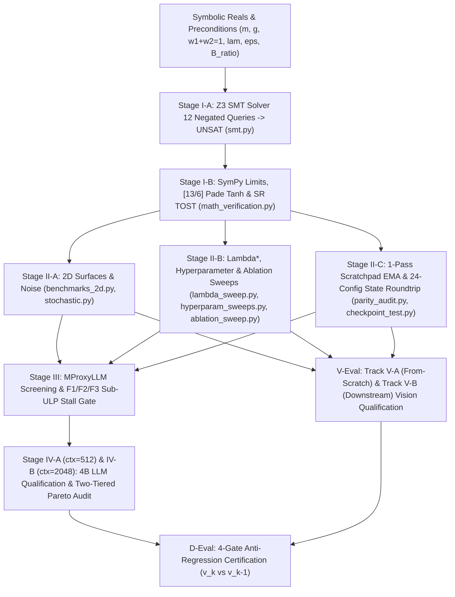

# LSO-Eval (`v1.1.0`): Formal Verification & Qualification Suite

The **LSO-Eval Suite (`v1.1.0`)** is an algorithm-agnostic formal mathematical verification, Z3 SMT solver invariant proof, 2D trajectory convergence, hyperparameter/ablation sweep, and hardware qualification standard under **PROJECT LOOMY**, developed by **Silver Moon ([@cloverxion](https://github.com/cloverxion))** and **Lumina Moon ([@cloverx-id](https://github.com/cloverx-id)) contributors**. It serves as the primary qualification gate for the **LuminaV Optimizer** and **LuminaMoon DataLoader** (`v1.0.8.post1`).

> **LSO-Eval v1.1.0 Interactive Qualification Notebook (`LuminaV v1.5.3` Empirical Run)**: [**Open in Google Colab**](https://colab.research.google.com/drive/1UepDza5Wm3KRNooCA2Bn69GIeKB21a4a?usp=sharing)
> *Note on Empirical Version Attribution (`LuminaV v1.5.3`)*: The Stage II–IV empirical benchmark tables reported below were evaluated on **`LuminaV v1.5.3`** under native `torch.bfloat16` (`centered_defect=False`). In the `v1.5.3` evaluation data loader script, parallel dataset records were sampled by filtering uniqueness based on joint `(source, domain)` pairs rather than allocating unique records evenly per domain up to each domain's total target allocation; because all candidate and baseline optimizers shared this identical deterministic stream schedule, relative cross-optimizer comparisons in the `v1.5.3` tables remain strictly controlled.

---

## LSO-Eval Staged Verification Pipeline



---

## Canonical Mathematical Specification (`LuminaV v1.5.3` Reference Case)

1. **Dual-Buffer Convex Lookahead Momentum (`buffer=2` / `CLM`)**:
   - Moments: `m_t = β₁ m_{t-1} + (1 - β₁) g_t`, `m̃_t = β₁ m_t + (1 - β₁) g_t`, `d_t^(B2) = g_t - m_t`, and `v_t = β₂ v_{t-1} + (1 - β₂) (d_t^(B2))²`.
   - Bias-corrected scalars: `bc_{1,t} = 1 - β₁^(t+1)`, `bc_{2,t} = max(1 - β₂^t, 10⁻¹⁵)`, `c₁ = bc_{1,t} τ / √(bc_{2,t})`, and `c₂ = ε_eff bc_{1,t} τ`.
   - Velocity: `σ_t = c₁ √(max(v_t, 0)) + c₂` and `u_t^(B2) = tanh_Pade(m̃_t / max(σ_t, 10⁻¹²)) ∈ (-1, 1)`.

2. **Single-Buffer Triangle-Defect Convex Lookahead Momentum (`buffer=1` / `TD-CLM`)**:
   - Convex weights: `w₁ = β₁²`, `w₂ = 1 - β₁²` (`w₁ + w₂ = 1`).
   - Lookahead numerator & instantaneous defect: `m̃_t = w₁ m_{t-1} + w₂ g_t`, `d_t^(B1) = g_t - m_{t-1}`.
   - **Triangle Inequality Envelope**:

```text
E_t = w_1 |m_{t-1}| + w_2 |g_t| + λ |d_t^(B1)| + ε_eff,    u_t^(B1) = m̃_t / E_t ∈ (-1, 1),    m_t = β₁ m_{t-1} + (1 - β₁) g_t
```

---

## LSO-Eval v1.1.0: Verified Formal & Empirical Qualification Summary

### 1. Stage I-A & I-B: Z3 SMT Formal Proofs & Symbolic/Bitwise Verification
- **Z3 SMT Solver (12/12 Negated Safety Queries -> `UNSAT`)**:
  - `1.` TD-CLM Div-Zero (`Q1`, `E_t ≤ 0`): `PASSED (UNSAT)`
  - `2.` TD-CLM Metric Bound (`Q2`, `|u_t^(B1)| ≥ 1.0`): `PASSED (UNSAT)`
  - `3.` Buffer-2 Sigma Positivity (`Q1/Q2`, `σ_t ≤ 0`): `PASSED (UNSAT)`
  - `4.` Cautious Scale Bounds (`Q3`, `γ_{c,t} ∉ [1, 1/c_min]`): `PASSED (UNSAT)`
  - `5–6.` Coordinate (`B > 0`) & Radial (`R ≥ B_ratio`) Governor Bounds (`Q2`): `PASSED (UNSAT)`
  - `7–8.` FP16 Safe-Zone Floor (`≥ 1.5 × 10⁻⁴`) & Subnormal/Variance Safety (`Q4`): `PASSED (UNSAT)`
  - `9.` Radial Scale Contraction (`Q3`, `s_radial ∈ (0, 1]`): `PASSED (UNSAT)`
  - `10.` Bias Correction Positivity (`Q7`, `t ≥ 1`): `PASSED (UNSAT)`
  - `11.` Weight Decay Contraction (`Q6`, `1 - ηω ∈ (0, 1]`): `PASSED (UNSAT)`
  - `12.` Descent Direction Alignment (`Q5`, `≥ 0`): `PASSED (UNSAT)`
- **SymPy & Bitwise Verification (9/9 `PASSED`)**:
  - `1.` Stochastic rounding & TOST (`S4`, `200k` samples): `PASSED | Max bias: 3.53e-07, TOST p: 0.00e+00`
  - `2.` Padé `[13/6]` tanh & symmetry (`S3`, `500k` points): `PASSED | Max error: 9.48e-08`
  - `3.` Radial boundary continuity (`S2`, `r = 10⁻⁴`): `PASSED | Step jump: 3.33e-09`
  - `4.` Learning rate schedule range: `PASSED | Warmup: 0.0->1.0, Min: 0.05`
  - `5.` TD-CLM limit & balance (`S1`): `PASSED | u_oo: 0.3878, lambda*: 0.3008`
  - `6.` Buffer 2 bias correction: `PASSED | Step 1: 4.8067, Step inf: 0.8000`
  - `7.` Cautious scaling range: `PASSED | Factor: [1.00, 2.00]`
  - `8.` Coordinate bound derivative: `PASSED | Derivative range: [0.0, 1.0]`
  - `9.` Weight decay multiplier: `PASSED | Range: [0.99950, 1.00000]`

### 2. Stage II: Synthetic Surfaces (`B1–B5`), `λ*` Equilibrium & 1-Pass EMA Parity

| Surface / Test | `Legacy_BCLM` | `LuminaV_Buffer1_TDCLM` | `LuminaV_Buffer2_Dual` | `AdamW_FP32_Master` | `AdamW_Native_BF16` |
| :--- | :--- | :--- | :--- | :--- | :--- |
| **`B1.` Quadratic Bowl (`κ=1000`, LR `0.02`)** | `950 steps` (`6.56e-06`) | **`575 steps` (`2.67e-06`)** | **`571 steps` (`9.31e-06`)** | `MAX_STEPS` (`3.66e-02`) | `MAX_STEPS` (`5.00e+01`) |
| **`B2.` Rosenbrock Valley (LR `0.002`, `2k` steps)** | `1.82e-04` | **`7.46e-04`** | `1.76e+00` | `3.90e+00` | `1.25e+01` |
| **`B3.` Stochastic Noise (`σ=1.0`, LR `0.01`)** | `1.79e-02` | `2.21e-01` | **`8.11e-02`** | `3.36e+00` | `5.00e+01` |
| **`B4.` Multimodal Rastrigin (LR `0.02`)** | `8.11e+00` | `7.9690` | **`7.9597`** | `7.9597` | `7.9617` |
| **`B5.` High-Dim Saddle (`N=100`, LR `0.02`)** | `MAX_STEPS` (`3.33`) | `MAX_STEPS` (`1.02`) | **`149 steps` (`5.25e-06`)** | `193 steps` (`6.47e-06`) | `196 steps` (`6.93e-06`) |

| `λ` | Spike Limit (u<sub>spike</sub>) | Reversal Limit (u<sub>rev</sub>) | Steps to `10⁻⁵` | Final Loss (B₁) | Empirical Regime |
| :--- | :--- | :--- | :--- | :--- | :--- |
| `0.00` | `1.0000` | `0.6200` | `950` | `4.22e-03` | Unregularized B-CLM |
| `0.10` | `0.6552` | `0.5167` | `628` | `4.58e-02` | Under-damped spike ceiling |
| `0.19` | `0.5000` | `0.4493` | `Max` | `1.91e-02` | Resonance (`w₂ = λ`) |
| **`0.30`** | **`0.3878`** | **`0.3875`** | **`575`** | **`2.06e-02`** | **Proposition 1 Equilibrium (`λ* = 0.3008`)** |
| `0.50` | `0.2754` | `0.3100` | `571` | `2.24e-04` | Over-damped velocity |
| `0.80` | `0.1919` | `0.2385` | `677` | `3.13e-05` | Strong steady-state damping |
| `1.00` | `0.1597` | `0.2067` | `642` | `8.75e-03` | Over-damped velocity |

- **1-Pass Fused Scratchpad EMA vs 2-Pass Instantaneous Parity**:
  - `Buffer 1 (Instantaneous 2-Pass)`: `381 steps | Loss: 6.78e-05` -> `Buffer 1 (Fused EMA decay=0.95 Default)`: **`346 steps | Loss: 2.52e-05 | Step Delta: -9.19% (CONVERGED)`**
  - `Buffer 2 (Instantaneous 2-Pass)`: `370 steps | Loss: 8.92e-05` -> `Buffer 2 (Fused EMA decay=0.80 Default)`: **`367 steps | Loss: 9.24e-05 | Step Delta: -0.81% (CONVERGED)`**

### 3. Stage III: Short-Run Proxy Model Screening (`LuminaV v1.5.3` on `MProxyLLM`, 500 Steps, `F₁ ∧ F₂ ∧ F₃`)

| Configuration | BF16 EMA | FP32 Ref | Max R<sub>t,l</sub> | Min R<sub>t,l</sub> | F₁ | F₂ | F₃ (ΔL<sub>stall</sub> < 0.25) | Verdict |
| :--- | :--- | :--- | :--- | :--- | :--- | :--- | :--- | :--- |
| **`LuminaV Buf 1 (1x, LR 8e-4)`** | `0.9018` | `0.9021` | `0.01574` | `1.24e-03` | `PASS` | `PASS` | `PASS` | **`QUALIFIED`** |
| **`LuminaV Buf 1 (4x, LR 8e-4)`** | **`0.8462`** | **`0.8462`** | `0.01602` | `1.24e-03` | `PASS` | `PASS` | `PASS` | **`QUALIFIED`** |
| **`LuminaV Buf 2 (1x, LR 8e-4)`** | `0.9146` | `0.9141` | `0.01604` | `1.03e-03` | `PASS` | `PASS` | `PASS` | **`QUALIFIED`** |
| **`LuminaV Buf 2 (4x, LR 8e-4)`** | `0.8518` | `0.8515` | `0.01684` | `9.81e-04` | `PASS` | `PASS` | `PASS` | **`QUALIFIED`** |
| **`LuminaV Buf 1 (1x, LR 1e-2)`** | `0.9326` | `0.9317` | `0.04041` | `3.03e-03` | `PASS` | `PASS` | `PASS` | **`QUALIFIED`** |
| `AdamW Native BF16 (1x, 8e-4)` | `0.9763` | `0.9552` | `0.01423` | `7.76e-05` | `PASS` | `PASS` | `PASS` | `QUALIFIED` |
| `AdamW Native BF16 (4x, 8e-4)` | `0.8767` | `0.8678` | `0.01600` | `7.50e-05` | `PASS` | `PASS` | `PASS` | `QUALIFIED` |
| `AdamW FP32 Master (1x, 3e-4)` | `1.0989` | `1.0992` | `0.00611` | `1.00e-04` | `PASS` | `PASS` | `PASS` | `QUALIFIED` |
| `AdamW FP32 Master (4x, 3e-4)` | `0.9693` | `0.9692` | `0.00708` | `1.00e-04` | `PASS` | `PASS` | `PASS` | `QUALIFIED` |

### 4. Stage IV: `Qwen/Qwen3.5-4B-Base` Hardware Qualification & Two-Tiered Pareto Audit (`LuminaV v1.5.3`)

> **VRAM Decomposition**: `VRAM_peak = VRAM_base + VRAM_opt`, where the fixed non-optimizer baseline (`VRAM_base = W_BF16 + G_BF16 + A_ctx`) is **`20.87 GB`** at `ctx=512` and **`28.03 GB`** at `ctx=2048`.

#### Stage IV-A: 512 Context Qualification (`4,800 Steps`, `Grad Accum 8x`, `450,560` Held-Out Tokens, `SHA256=4d278cb87e4abbe1`)

| Optimizer Configuration | Class | Final EMA | Val PPL | ΔPPL | VRAM<sub>peak</sub> | **VRAM<sub>opt</sub>** | Max R<sub>t,l</sub> | Step / Opt Time | LSO-Eval Status |
| :--- | :--- | :---: | :---: | :---: | :---: | :---: | :---: | :---: | :--- |
| `LuminaV_Buffer2_Dual` (`8e-4`) | Class I (Dual) | **`4.7621`** | **`141.96`** | **`-39.21`** | `36.75 GB` | `15.88 GB` | `0.0047` | `841.6 / 48.37 ms` | **`PASSED (Class I)`** |
| `LuminaV_Buffer1_TDCLM_3e4` (`3e-4`) | Class II (Single) | `5.2569` | `195.58` | `+14.41` | **`28.81 GB`** | **`7.94 GB (-50.0%)`** | `0.0120` | **`829.4 / 36.77 ms`** | **`PASSED (Class II)`** |
| `LuminaV_Buffer1_TDCLM` (`8e-4`) | Class II (Single) | `5.2953` | `221.07` | `+39.90` | **`28.81 GB`** | **`7.94 GB (-50.0%)`** | `0.0191` | **`830.7 / 36.46 ms`** | **`PASSED (Class II)`** |
| `AdamW` (Native BF16, `3e-4`) | Baseline | `5.4497` | `181.17` | `+0.00` | `36.75 GB` | `15.88 GB` | `0.0034` | `835.4 / 41.58 ms` | `PASSED` |
| `AdamW_FP32_Master` (`3e-4`) | Master Ref | `5.0234` | `153.78` | `-27.39` | `75.36 GB` | `54.49 GB` | `0.0040` | `919.5 / 123.35 ms` | `PASSED` |

#### Stage IV-B: 2048 Context Full Schedule (`20,000 Steps`, `Grad Accum 1x`, `450,560` Held-Out Tokens, `SHA256=108e517e1c181cb6`)

| Optimizer Configuration | Class | Final EMA | Val PPL | ΔPPL | VRAM<sub>peak</sub> | **VRAM<sub>opt</sub>** | Max R<sub>t,l</sub> | Step / Opt Time | LSO-Eval Status |
| :--- | :--- | :---: | :---: | :---: | :---: | :---: | :---: | :---: | :--- |
| `LuminaV_Buffer2_Dual` (`8e-4`) | Class I (Dual) | **`4.5549`** | **`89.14`** | **`-43.43`** | `43.89 GB` | `15.86 GB` | `0.0189` | `297.1 / 48.31 ms` | **`PASSED (Class I)`** |
| `LuminaV_Buffer1_TDCLM_3e4` (`3e-4`) | Class II (Single) | `4.9173` | `165.13` | `+32.56` | **`35.97 GB`** | **`7.94 GB (-50.0%)`** | `0.0087` | **`283.5 / 36.99 ms`** | **`PASSED (Class II)`** |
| `AdamW` (Native BF16, `3e-4`) | Baseline | `4.7621` | `132.57` | `+0.00` | `43.89 GB` | `15.86 GB` | `0.0037` | `288.0 / 41.48 ms` | `PASSED` |
| `AdamW_FP32_Master` (`3e-4`) | Master Ref | `4.8116` | `124.43` | `-8.14` | `80.11 GB` | `52.08 GB` | `0.0045` | `370.1 / 123.33 ms` | `PASSED` |

---

## Repository Suite Components (Stages I & II Self-Contained CPU Suite)

| Component | Path | Stage | Description |
| :--- | :--- | :--- | :--- |
| **Execution Harness** | [`run_all.py`](run_all.py) | Stages I–II | Master evaluation orchestrator executing all 9 Stage I & Stage II verification modules sequentially (`python -m eval`). |
| **Z3 SMT Solver Suite** | [`modules/smt.py`](modules/smt.py) | Stage I-A | Formal Z3 theorem prover checks across 12 negated safety queries (`Q1–Q7`: div-by-zero, `\|u_t\| < 1`, FP16 subnormal floor, cautious/radial/coordinate bounds, weight decay, descent alignment). |
| **Calculus & Bitwise Audit** | [`modules/math_verification.py`](modules/math_verification.py) | Stage I-B | SymPy large-gradient limit (`u_∞`), radial `C⁰/C¹` continuity, `[13/6]` Padé `tanh` error, and `200k`-sample MurmurHash3 stochastic rounding TOST unbiasedness. |
| **2D Surface & Noise Suite** | [`modules/benchmarks_2d.py`](modules/benchmarks_2d.py), [`modules/stochastic.py`](modules/stochastic.py) | Stage II-A | 5-optimizer trajectory comparisons (`Legacy_BCLM`, `LuminaV_Buffer1_TDCLM`, `LuminaV_Buffer2_Dual`, `AdamW_FP32_Master`, `AdamW_Native_BF16`) across `B1–B5` surfaces. |
| **Lambda* & Ablation Sweeps** | [`modules/lambda_sweep.py`](modules/lambda_sweep.py), [`modules/hyperparam_sweeps.py`](modules/hyperparam_sweeps.py), [`modules/ablation_sweep.py`](modules/ablation_sweep.py) | Stage II-B | Proposition 1 equilibrium (`λ* = 0.3008`), `±30%` stability sweeps, and 12-combination feature ablation matrix. |
| **1-Pass EMA & State Roundtrip** | [`modules/parity_audit.py`](modules/parity_audit.py), [`modules/checkpoint_test.py`](modules/checkpoint_test.py) | Stage II-C | 1-Pass Fused Scratchpad vs 2-Pass exact EMA trajectory convergence and 24-configuration `state_dict` deterministic resumption. |
| **Standalone Runner** | [`stage1_smt_and_precision.py`](stage1_smt_and_precision.py) | Stages I–II | Self-contained single-file verification script executing all Stage I and Stage II checks. |
| **Vision Qualification (`V-Eval`)** | [`v_eval_suite.py`](v_eval_suite.py), [`modules/v_eval.py`](modules/v_eval.py) | V-Eval (V-A & V-B) | Standalone Vision & Spatial Modality Qualification suite (`SimpleLion`, `split_vision_parameter_groups`, 6-contender factory, official upstream `timm`/`torchvision`/`transformers`/`SiT` loaders, and Two-Tiered Pareto evaluator). |
| **Formal Specification** | [`lso_eval_specification.tex`](lso_eval_specification.tex) | Stages I–IV, V-Eval & D-Eval | Complete **LSO-Eval v1.1.0** formal engineering standard, mathematical proofs, Stage III/IV LLM & V-Eval Vision qualification tables, Two-Tiered Pareto criteria, and 27-reference bibliography. |
| **PDF Manuscript (`v1.1.0`)** | [`LSO-Eval.pdf`](LSO-Eval.pdf) | All Stages | Compiled **LSO-Eval v1.1.0** formal specification paper. |
| **Stage IV Empirical Archive (`v1.5.3`)** | [`artifacts/v1.5.3/`](artifacts/v1.5.3/) | Stage IV & D-Eval | Archived `LuminaV v1.5.3` Stage IV-A/B telemetry JSONs, convergence plots, `450,560`-token held-out validation tensors (`.pt`), XXH3-64 WAL hash tables (`.dedup`), and `LMDL` state headers (`.meta`). |
| **Legacy Specification Archive** | [`Legacy/LSO-Eval_v1.0.0.pdf`](Legacy/LSO-Eval_v1.0.0.pdf) | Archive | Archived **LSO-Eval v1.0.0** specification manuscript. |

---

## Running Verification

```bash
# Execute full 9-module Stage I & Stage II formal verification suite
python -m eval

# Or run standalone Stage I & Stage II script directly
python eval/stage1_smt_and_precision.py

# Run V-Eval (Vision & Spatial Modality Qualification) 6-contender CI verification
python eval/v_eval_suite.py --verify-architecture
```
