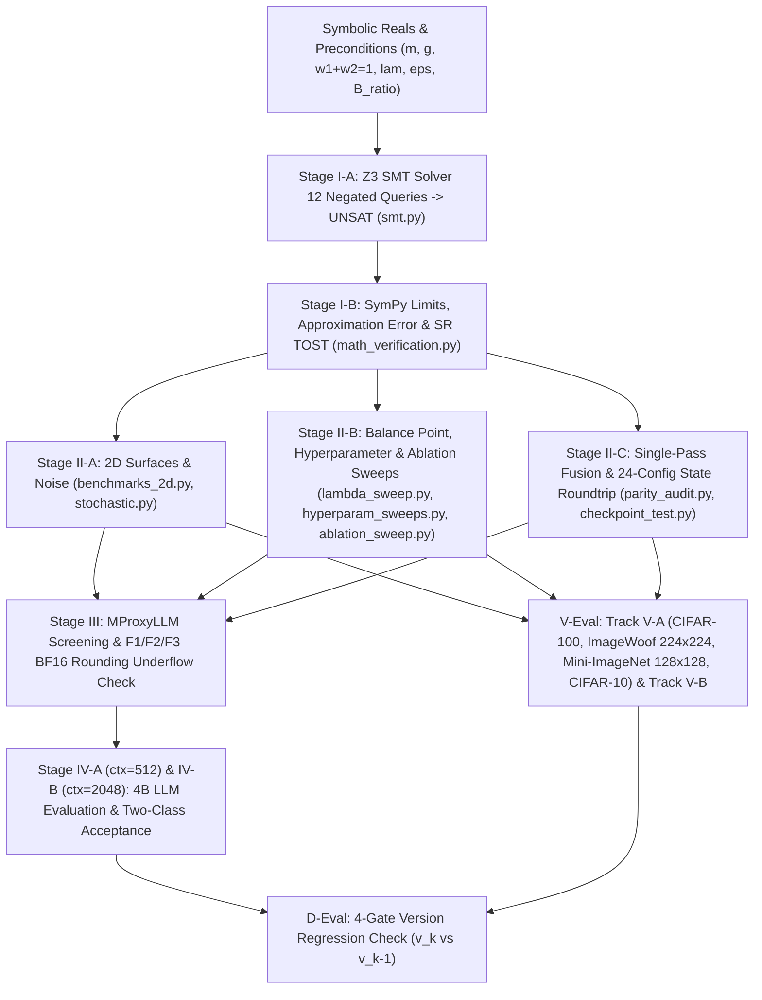

# LSO-Eval (`v1.1.1`): Optimizer Evaluation & Verification

**LSO-Eval (`v1.1.1`)** is an algorithm-agnostic mathematical verification, Z3 SMT solver invariant check, 2D trajectory benchmark, hyperparameter/ablation sweep, and empirical evaluation procedure developed by **Silver Moon ([@cloverxion](https://github.com/cloverxion))** and **Lumina Moon ([@cloverx-id](https://github.com/cloverx-id)) contributors**. Reference case benchmarks throughout this document illustrate the procedure on the **LuminaV Optimizer** (`v1.5.3`) with data processing powered by **LuminaMoon Data Engine** (`v1.0.9`).

> **LSO-Eval v1.1.1 Interactive Evaluation Notebook (`LuminaV v1.5.3` Empirical Run)**: [**Open in Google Colab**](https://colab.research.google.com/drive/1UepDza5Wm3KRNooCA2Bn69GIeKB21a4a?usp=sharing)
> *Note on Empirical Version Attribution (`LuminaV v1.5.3`)*: The Stage II–IV empirical benchmark tables reported below were evaluated on **`LuminaV v1.5.3`** under native `torch.bfloat16` (`centered_defect=False`). In the `v1.5.3` evaluation data loader script, parallel dataset records were sampled by filtering uniqueness based on joint `(source, domain)` pairs rather than allocating unique records evenly per domain up to each domain's total target allocation; because all candidate and baseline optimizers shared this identical deterministic stream schedule, relative cross-optimizer comparisons in the `v1.5.3` tables remain controlled.

---

## LSO-Eval Staged Evaluation Pipeline



---

## Reference Case Mathematical Specification (`LuminaV v1.5.3`)

1. **Dual-Buffer Convex Lookahead Momentum (`buffer=2` / `CLM`)**:
   - Moments:

     $\displaystyle m_t = \beta_1 m _ {t-1} + (1 - \beta_1) g_t, \qquad \tilde{m} _ t = \beta_1 m_t + (1 - \beta_1) g_t$

     $\displaystyle d_t^{(\text{B2})} = g_t - m_t, \qquad v_t = \beta_2 v _ {t-1} + (1 - \beta_2) \left(d_t^{(\text{B2})}\right)^2$

   - Bias-corrected scalars:

     $\displaystyle \hat{\beta} _ {1,t} = 1 - \beta_1^{t+1}, \qquad \hat{\beta} _ {2,t} = \max(1 - \beta_2^t, 10^{-15}), \qquad c_1 = \frac{\hat{\beta} _ {1,t} \tau}{\sqrt{\hat{\beta} _ {2,t}}}, \qquad c_2 = \epsilon _ {\text{eff}} \hat{\beta} _ {1,t} \tau$

   - Velocity:

     $\displaystyle \sigma_t = c_1 \sqrt{\max(v_t, 0)} + c_2, \qquad u_t^{(\text{B2})} = \tanh _ {\text{Pade}}\left(\frac{\tilde{m} _ t}{\max(\sigma_t, 10^{-12})}\right) \in (-1, 1)$

2. **Single-Buffer Triangle-Defect Convex Lookahead Momentum (`buffer=1` / `TD-CLM`)**:
   - Convex weights: $w_1 = \beta_1^2, \quad w_2 = 1 - \beta_1^2 \quad (w_1 + w_2 = 1)$
   - Lookahead numerator & gradient-momentum residual:

     $\displaystyle \tilde{m} _ t = w_1 m _ {t-1} + w_2 g_t, \qquad d_t^{(\text{B1})} = g_t - m _ {t-1}$

   - **Triangle Inequality Envelope**:

     $\displaystyle \mathcal{E} _ t = w_1 |m _ {t-1}| + w_2 |g_t| + \lambda |d_t^{(\text{B1})}| + \epsilon _ {\text{eff}}, \qquad u_t^{(\text{B1})} = \frac{\tilde{m} _ t}{\mathcal{E} _ t} \in (-1, 1), \qquad m_t = \beta_1 m _ {t-1} + (1 - \beta_1) g_t$

---

## LSO-Eval v1.1.1: Reference Verification & Empirical Summary (`LuminaV v1.5.3`)

### 1. Stage I-A & I-B: Z3 SMT Proofs & Symbolic/Bitwise Checks
- **Z3 SMT Solver (12/12 Negated Safety Queries -> `UNSAT`)**:
  - `1.` TD-CLM Div-Zero (`Q1`, `E_t ≤ 0`): `PASSED (UNSAT)`
  - `2.` TD-CLM Metric Bound (`Q2`, `|u_t^(B1)| ≥ 1.0`): `PASSED (UNSAT)`
  - `3.` Buffer-2 Sigma Positivity (`Q1/Q2`, `σ_t ≤ 0`): `PASSED (UNSAT)`
  - `4.` Cautious Scale Bounds (`Q3`, `γ_{c,t} ∉ [1, 1/c_min]`): `PASSED (UNSAT)`
  - `5–6.` Coordinate (`B > 0`) & Radial (`R ≥ B_ratio`) Clipping Bounds (`Q2`): `PASSED (UNSAT)`
  - `7–8.` FP16 Floor (`≥ 1.5 × 10⁻⁴`) & Subnormal/Variance Bounds (`Q4`): `PASSED (UNSAT)`
  - `9.` Radial Scale Contraction (`Q3`, `s_radial ∈ (0, 1]`): `PASSED (UNSAT)`
  - `10.` Bias Correction Positivity (`Q7`, `t ≥ 1`): `PASSED (UNSAT)`
  - `11.` Weight Decay Contraction (`Q6`, `1 - ηω ∈ (0, 1]`): `PASSED (UNSAT)`
  - `12.` Descent Direction Alignment (`Q5`, `≥ 0`): `PASSED (UNSAT)`
- **SymPy & Bitwise Precision Checks (9/9 `PASSED`)**:
  - `1.` Stochastic rounding & TOST (`S4`, `200k` samples): `PASSED | Max bias: 3.53e-07, TOST p: 0.00e+00`
  - `2.` Padé `[13/6]` tanh & symmetry (`S3`, `500k` points): `PASSED | Max error: 9.48e-08`
  - `3.` Radial boundary continuity (`S2`, `r = 10⁻⁴`): `PASSED | Step jump: 3.33e-09`
  - `4.` Learning rate schedule range: `PASSED | Warmup: 0.0->1.0, Min: 0.05`
  - `5.` TD-CLM limit & balance (`S1`): `PASSED | u_oo: 0.3878, lambda*: 0.3008`
  - `6.` Buffer 2 bias correction: `PASSED | Step 1: 4.8067, Step inf: 0.8000`
  - `7.` Cautious scaling range: `PASSED | Factor: [1.00, 2.00]`
  - `8.` Coordinate bound derivative: `PASSED | Derivative range: [0.0, 1.0]`
  - `9.` Weight decay multiplier: `PASSED | Range: [0.99950, 1.00000]`

### 2. Stage II: Synthetic Surfaces (`B1–B5`), `λ*` Balance & 1-Pass EMA Parity

| Surface / Test | `Legacy_BCLM` | `LuminaV_Buffer1_TDCLM` | `LuminaV_Buffer2_Dual` | `AdamW_FP32_Master` | `AdamW_Native_BF16` |
| :--- | :--- | :--- | :--- | :--- | :--- |
| **`B1.` Quadratic Bowl (`κ=1000`, LR `0.02`)** | `950 steps` (`6.56e-06`) | **`575 steps` (`2.67e-06`)** | **`571 steps` (`9.31e-06`)** | `MAX_STEPS` (`3.66e-02`) | `MAX_STEPS` (`5.00e+01`) |
| **`B2.` Rosenbrock Valley (LR `0.002`, `2k` steps)** | `1.82e-04` | **`7.46e-04`** | `1.76e+00` | `3.90e+00` | `1.25e+01` |
| **`B3.` Stochastic Noise (`σ=1.0`, LR `0.01`)** | `1.79e-02` | `2.21e-01` | **`8.11e-02`** | `3.36e+00` | `5.00e+01` |
| **`B4.` Multimodal Rastrigin (LR `0.02`)** | `8.11e+00` | `7.9690` | **`7.9597`** | `7.9597` | `7.9617` |
| **`B5.` High-Dim Saddle (`N=100`, LR `0.02`)** | `MAX_STEPS` (`3.33`) | `MAX_STEPS` (`1.02`) | **`149 steps` (`5.25e-06`)** | `193 steps` (`6.47e-06`) | `196 steps` (`6.93e-06`) |

| `λ` | Spike Limit (u<sub>spike</sub>) | Reversal Limit (u<sub>rev</sub>) | Steps to `10⁻⁵` | Final Loss (B₁) | Empirical Regime |
| :--- | :--- | :--- | :--- | :--- | :--- |
| `0.00` | `1.0000` | `0.6200` | `950` | `4.22e-03` | Unregularized B-CLM |
| `0.10` | `0.6552` | `0.5167` | `628` | `4.58e-02` | Under-damped spike ceiling |
| `0.19` | `0.5000` | `0.4493` | `Max` | `1.91e-02` | Resonance (`w₂ = λ`) |
| **`0.30`** | **`0.3878`** | **`0.3875`** | **`575`** | **`2.06e-02`** | **Proposition 1 Balance (`λ* = 0.3008`)** |
| `0.50` | `0.2754` | `0.3100` | `571` | `2.24e-04` | Over-damped velocity |
| `0.80` | `0.1919` | `0.2385` | `677` | `3.13e-05` | Strong steady-state damping |
| `1.00` | `0.1597` | `0.2067` | `642` | `8.75e-03` | Over-damped velocity |

- **1-Pass Fused Scratchpad EMA vs 2-Pass Instantaneous Parity**:
  - `Buffer 1 (Instantaneous 2-Pass)`: `381 steps | Loss: 6.78e-05` -> `Buffer 1 (Fused EMA decay=0.95 Default)`: **`346 steps | Loss: 2.52e-05 | Step Delta: -9.19% (CONVERGED)`**
  - `Buffer 2 (Instantaneous 2-Pass)`: `370 steps | Loss: 8.92e-05` -> `Buffer 2 (Fused EMA decay=0.80 Default)`: **`367 steps | Loss: 9.24e-05 | Step Delta: -0.81% (CONVERGED)`**

### 3. Stage III: Short-Run Proxy Model Screening (`LuminaV v1.5.3` on `MProxyLLM`, 500 Steps, `F₁ ∧ F₂ ∧ F₃`)

| Configuration | BF16 EMA | FP32 Ref | Max R<sub>t,l</sub> | Min R<sub>t,l</sub> | F₁ | F₂ | F₃ (ΔL<sub>stall</sub> < 0.25) | Verdict |
| :--- | :--- | :--- | :--- | :--- | :--- | :--- | :--- | :--- |
| **`LuminaV Buf 1 (1x, LR 8e-4)`** | `0.9018` | `0.9021` | `0.01574` | `1.24e-03` | `PASS` | `PASS` | `PASS` | **`PASSED`** |
| **`LuminaV Buf 1 (4x, LR 8e-4)`** | **`0.8462`** | **`0.8462`** | `0.01602` | `1.24e-03` | `PASS` | `PASS` | `PASS` | **`PASSED`** |
| **`LuminaV Buf 2 (1x, LR 8e-4)`** | `0.9146` | `0.9141` | `0.01604` | `1.03e-03` | `PASS` | `PASS` | `PASS` | **`PASSED`** |
| **`LuminaV Buf 2 (4x, LR 8e-4)`** | `0.8518` | `0.8515` | `0.01684` | `9.81e-04` | `PASS` | `PASS` | `PASS` | **`PASSED`** |
| **`LuminaV Buf 1 (1x, LR 1e-2)`** | `0.9326` | `0.9317` | `0.04041` | `3.03e-03` | `PASS` | `PASS` | `PASS` | **`PASSED`** |
| `AdamW Native BF16 (1x, 8e-4)` | `0.9763` | `0.9552` | `0.01423` | `7.76e-05` | `PASS` | `PASS` | `PASS` | `PASSED` |
| `AdamW Native BF16 (4x, 8e-4)` | `0.8767` | `0.8678` | `0.01600` | `7.50e-05` | `PASS` | `PASS` | `PASS` | `PASSED` |
| `AdamW FP32 Master (1x, 3e-4)` | `1.0989` | `1.0992` | `0.00611` | `1.00e-04` | `PASS` | `PASS` | `PASS` | `PASSED` |
| `AdamW FP32 Master (4x, 3e-4)` | `0.9693` | `0.9692` | `0.00708` | `1.00e-04` | `PASS` | `PASS` | `PASS` | `PASSED` |

### 4. Stage IV: `Qwen/Qwen3.5-4B-Base` Evaluation & Two-Class Acceptance (`LuminaV v1.5.3`)

> **Memory Metric Clarification**: In benchmark run logs and artifacts, memory values represent **peak allocated tensor memory** (`torch.cuda.max_memory_allocated()`), while total physical VRAM reserved by the CUDA caching allocator in `nvidia-smi` is larger due to framework caching and memory pool fragmentation (e.g. ~57 GB physical reservation for ~43.89 GB allocated). The optimizer state memory (`Opt State`) reflects the analytical state tensor footprint ($15.88\text{ GB}$ for 2-buffer / 8 bytes per parameter vs $7.94\text{ GB}$ for single-buffer / 4 bytes per parameter, yielding an exact $-50.0\%$ reduction).

#### Stage IV-A: 512 Context Run (`4,800 Steps`, `Grad Accum 8x`, `450,560` Held-Out Tokens, `SHA256=4d278cb87e4abbe1`)

| Optimizer Configuration | Class | Final EMA | Val PPL | ΔPPL | Peak Allocated | **Opt State** | Max R<sub>t,l</sub> | Step / Opt Time | LSO-Eval Status |
| :--- | :--- | :---: | :---: | :---: | :---: | :---: | :---: | :---: | :--- |
| `LuminaV_Buffer2_Dual` (`8e-4`) | Class I (Dual) | **`4.7621`** | **`141.96`** | **`-39.21`** | `36.75 GB` | `15.88 GB` | `0.0047` | `841.6 / 48.37 ms` | **`PASSED (Class I)`** |
| `LuminaV_Buffer1_TDCLM_3e4` (`3e-4`) | Class II (Single) | `5.2569` | `195.58` | `+14.41` | **`28.81 GB`** | **`7.94 GB (-50.0%)`** | `0.0120` | **`829.4 / 36.77 ms`** | **`PASSED (Class II)`** |
| `LuminaV_Buffer1_TDCLM` (`8e-4`) | Class II (Single) | `5.2953` | `221.07` | `+39.90` | **`28.81 GB`** | **`7.94 GB (-50.0%)`** | `0.0191` | **`830.7 / 36.46 ms`** | **`PASSED (Class II)`** |
| `AdamW` (Native BF16, `3e-4`) | Baseline | `5.4497` | `181.17` | `+0.00` | `36.75 GB` | `15.88 GB` | `0.0034` | `835.4 / 41.58 ms` | `PASSED` |
| `AdamW_FP32_Master` (`3e-4`) | Master Ref | `5.0234` | `153.78` | `-27.39` | `75.36 GB` | `54.49 GB` | `0.0040` | `919.5 / 123.35 ms` | `PASSED` |

#### Stage IV-B: 2048 Context Full Schedule (`20,000 Steps`, `Grad Accum 1x`, `450,560` Held-Out Tokens, `SHA256=108e517e1c181cb6`)

| Optimizer Configuration | Class | Final EMA | Val PPL | ΔPPL | Peak Allocated | **Opt State** | Max R<sub>t,l</sub> | Step / Opt Time | LSO-Eval Status |
| :--- | :--- | :---: | :---: | :---: | :---: | :---: | :---: | :---: | :--- |
| `LuminaV_Buffer2_Dual` (`8e-4`) | Class I (Dual) | **`4.5549`** | **`89.14`** | **`-43.43`** | `43.89 GB` | `15.86 GB` | `0.0189` | `297.1 / 48.31 ms` | **`PASSED (Class I)`** |
| `LuminaV_Buffer1_TDCLM_3e4` (`3e-4`) | Class II (Single) | `4.9173` | `165.13` | `+32.56` | **`35.97 GB`** | **`7.94 GB (-50.0%)`** | `0.0087` | **`283.5 / 36.99 ms`** | **`PASSED (Class II)`** |
| `AdamW` (Native BF16, `3e-4`) | Baseline | `4.7621` | `132.57` | `+0.00` | `43.89 GB` | `15.86 GB` | `0.0037` | `288.0 / 41.48 ms` | `PASSED` |
| `AdamW_FP32_Master` (`3e-4`) | Master Ref | `4.8116` | `124.43` | `-8.14` | `80.11 GB` | `52.08 GB` | `0.0045` | `370.1 / 123.33 ms` | `PASSED` |

### 5. V-Eval: Vision Evaluation Matrix (Track V-A & Track V-B)

| Code | Track | Model Backbone | Dataset & Resolution | Default Schedule (`bs=256` / FT) | Contenders Evaluated |
| :--- | :--- | :--- | :--- | :--- | :--- |
| **`V-A1`** | From-Scratch | `ResNet-50` (CIFAR 3x3 stem, ~23.7M) | **CIFAR-100** (`32x32`, 100 cls) | `100 Ep` (`19.5k` steps, `5 Ep` warmup) | 6 Contenders (`LuminaV Buf 1/2`, `AdamW BF16/FP32`, `Lion BF16/FP32`) |
| **`V-A2`** | From-Scratch | `NF-ResNet-50` (Norm-Free, ~25.6M) | **ImageWoof** (`224x224`, 10 cls) | `100 Ep` (`3.7k` steps, `5 Ep` warmup) | 6 Contenders (`LuminaV Buf 1/2`, `AdamW BF16/FP32`, `Lion BF16/FP32`) |
| **`V-A3`** | From-Scratch | `ConvNeXt-V2-Tiny` (~28.6M) | **Mini-ImageNet** (`128x128`, 100 cls) | `100 Ep` (`19.5k` steps, `10 Ep` warmup) | 6 Contenders (`LuminaV Buf 1/2`, `AdamW BF16/FP32`, `Lion BF16/FP32`) |
| **`V-A4`** | From-Scratch | `ViT-Small` (Patch 8x8, ~22.0M) | **Mini-ImageNet** (`128x128`, 100 cls) | `100 Ep` (`19.5k` steps, `10 Ep` warmup) | 6 Contenders (`LuminaV Buf 1/2`, `AdamW BF16/FP32`, `Lion BF16/FP32`) |
| **`V-A5`** | From-Scratch | `SiT-S/2` (Flow Matching, ~33.0M) | **CIFAR-10** (`32x32`, 10 cls) | `100 Ep` (`19.5k` steps, `5 Ep` warmup) | 6 Contenders (`LuminaV Buf 1/2`, `AdamW BF16/FP32`, `Lion BF16/FP32`) |
| **`V-B1`** | Fine-Tuning | `RT-DETR-R18` / `YOLOv11-S` / `FCOS` | **cppe-5 / VOC 2007** (`480x480`) | `25 Ep` (`bs=16`, `2 Ep` warmup) | 6 Contenders (`LuminaV Buf 1/2`, `AdamW BF16/FP32`, `Lion BF16/FP32`) |
| **`V-B2`** | Fine-Tuning | `ViT-Base/16` & `ConvNeXt-Base` | **Oxford-IIIT Pet** (`224x224`, 37 cls) | `20 Ep` (`bs=64`, `2 Ep` warmup) | 6 Contenders (`LuminaV Buf 1/2`, `AdamW BF16/FP32`, `Lion BF16/FP32`) |

---

## Repository Components

| Component | Path | Stage | Description |
| :--- | :--- | :--- | :--- |
| **Execution Harness** | [`run_all.py`](run_all.py) | Stages I–II & V-Eval | Master evaluation runner executing all Stage I, Stage II, and V-Eval CI verification modules (`python -m eval`). |
| **Z3 SMT Solver** | [`modules/smt.py`](modules/smt.py) | Stage I-A | Z3 theorem prover checks across 12 negated safety queries (`Q1–Q7`: div-by-zero, `\|u_t\| < 1`, FP16 subnormal floor, cautious/radial/coordinate bounds, weight decay, descent alignment). |
| **Calculus & Bitwise Checks** | [`modules/math_verification.py`](modules/math_verification.py) | Stage I-B | SymPy large-gradient limit (`u_∞`), radial `C⁰/C¹` continuity, `[13/6]` Padé `tanh` error, and `200k`-sample MurmurHash3 stochastic rounding TOST unbiasedness. |
| **2D Surface & Noise** | [`modules/benchmarks_2d.py`](modules/benchmarks_2d.py), [`modules/stochastic.py`](modules/stochastic.py) | Stage II-A | 5-optimizer trajectory comparisons (`Legacy_BCLM`, `LuminaV_Buffer1_TDCLM`, `LuminaV_Buffer2_Dual`, `AdamW_FP32_Master`, `AdamW_Native_BF16`) across `B1–B5` surfaces. |
| **Balance & Ablation Sweeps** | [`modules/lambda_sweep.py`](modules/lambda_sweep.py), [`modules/hyperparam_sweeps.py`](modules/hyperparam_sweeps.py), [`modules/ablation_sweep.py`](modules/ablation_sweep.py) | Stage II-B | Proposition 1 balance (`λ* = 0.3008`), `±30%` stability sweeps, and 12-combination feature ablation matrix. |
| **1-Pass EMA & State Roundtrip** | [`modules/parity_audit.py`](modules/parity_audit.py), [`modules/checkpoint_test.py`](modules/checkpoint_test.py) | Stage II-C | 1-Pass Fused Scratchpad vs 2-Pass exact EMA trajectory convergence and 24-configuration `state_dict` deterministic resumption. |
| **Standalone Runner** | [`stage1_smt_and_precision.py`](stage1_smt_and_precision.py) | Stages I–II | Self-contained single-file verification script executing all Stage I and Stage II checks. |
| **Vision Evaluation (`V-Eval`)** | [`v_eval_suite.py`](v_eval_suite.py), [`modules/v_eval.py`](modules/v_eval.py) | V-Eval (V-A & V-B) | Standalone Vision Evaluation runner (`SimpleLion`, `split_vision_parameter_groups`, 6-contender factory, official upstream `timm`/`torchvision`/`transformers`/`SiT` loaders, and Two-Class acceptance evaluator). |
| **Technical Specification** | [`lso_eval_specification.tex`](lso_eval_specification.tex) | Stages I–IV, V-Eval & D-Eval | Complete **LSO-Eval v1.1.1** technical specification, mathematical proofs, Stage III/IV LLM & V-Eval Vision evaluation tables, Two-Class acceptance criteria, and 27-reference bibliography. |
| **PDF Manuscript (`v1.1.1`)** | [`LSO_Eval.pdf`](LSO_Eval.pdf) | All Stages | Compiled **LSO-Eval v1.1.1** specification document. |
| **Stage IV Empirical Reproduction** | [Google Colab Notebook](https://colab.research.google.com/drive/1UepDza5Wm3KRNooCA2Bn69GIeKB21a4a?usp=sharing) | Stage IV & D-Eval | Interactive Google Colab notebook reproducing Stage IV-A/B empirical evaluation runs, held-out validation streams, and convergence metrics. |


### Stage IV Interactive Empirical Reproduction (`LuminaV v1.5.3`)

To keep the repository lightweight while preserving full empirical reproducibility, Stage IV-A/B evaluation benchmarks, telemetry, and held-out validation streams are executable directly via Google Colab:

- **Interactive Reproduction Notebook**: [**Open in Google Colab**](https://colab.research.google.com/drive/1UepDza5Wm3KRNooCA2Bn69GIeKB21a4a?usp=sharing)
- **Held-Out Validation Multiset**: Deterministic integer token ID tensors ($450,560$ tokens total: $880 \times 512$ for Stage IV-A with `SHA256=4d278cb87e4abbe1`, and $220 \times 2048$ for Stage IV-B with `SHA256=108e517e1c181cb6`) evaluated across all optimizers under native `torch.bfloat16`.
- **Deduplication Integrity**: Binary 64-bit `xxh3_64` write-ahead logs verifying zero data leakage between streaming training batches and validation slices.

---

## Running Verification

```bash
# Execute Stage I, Stage II & V-Eval verification
python -m eval

# Or run standalone Stage I & Stage II script directly
python eval/stage1_smt_and_precision.py

# Run V-Eval (Vision Evaluation) 6-contender CI verification
python eval/v_eval_suite.py --verify-architecture
```

---

## References

- **Decoupled Weight Decay (`AdamW`)**: I. Loshchilov and F. Hutter, "Decoupled weight decay regularization," *ICLR*, 2019.
- **Sign-Momentum Optimization (`Lion`)**: X. Chen *et al.*, "Symbolic discovery of optimization algorithms," *NeurIPS*, vol. 36, pp. 49205–49233, 2023.
- **Belief Variance & Lagged Decorrelation (`AdaBelief`, `ADOPT`)**: J. Zhuang *et al.*, "AdaBelief optimizer: Adapting stepsizes by the belief in observed gradients," *NeurIPS*, 2020; S. Taniguchi *et al.*, "ADOPT: Modified Adam can converge with any β₂ with the optimal rate," *NeurIPS*, 2024.
- **Triangle Inequality Defect & Lookahead**: L. Maligranda, "Some remarks on the triangle inequality for norms," *Banach J. Math. Anal.*, vol. 2, no. 2, pp. 31–41, 2008; M. R. Zhang *et al.*, "Lookahead optimizer: k steps forward, 1 step back," *NeurIPS*, 2019.
- **Cautious Alignment Masking & Adaptive Gradient Clipping**: K. Liang *et al.*, "Cautious optimizers: Improving training with one line of code," *ICLR*, 2026; A. Brock *et al.*, "High-performance large-scale image recognition without normalization," *ICML*, 2021.
- **Memory-Efficient Optimizers & Low-Precision Rounding**: T. Dettmers *et al.*, "8-bit optimizers via block-wise quantization," *ICLR*, 2022; J. Zhao *et al.*, "GaLore: Memory-efficient LLM training by gradient low-rank projection," *ICML*, 2024; S. Gupta *et al.*, "Deep learning with limited numerical precision," *ICML*, 2015; P. Zamirai *et al.*, "Revisiting BFloat16 training," *arXiv:2010.06192*, 2021.
- **Formal Verification & Rational Approximations**: L. de Moura and N. Bjørner, "Z3: An efficient SMT solver," *TACAS*, 2008; A. Meurer *et al.*, "SymPy: Symbolic computing in Python," *PeerJ Comput. Sci.*, 2017; A. Molina *et al.*, "Padé activation units," *ICLR*, 2020.
- **Vision Evaluation Backbones (`V-Eval`)**: K. He *et al.*, "Deep residual learning for image recognition," *CVPR*, 2016; S. Woo *et al.*, "ConvNeXt V2: Co-designing and scaling ConvNets with masked autoencoders," *CVPR*, pp. 16133–16142, 2023; A. Dosovitskiy *et al.*, "An image is worth 16x16 words," *ICLR*, 2021; Y. Lipman *et al.*, "Flow matching for generative modeling," *ICLR*, 2023; N. Ma *et al.*, "SiT: Exploring flow and diffusion-based generative models with scalable interpolant transformers," *ECCV*, 2024.
