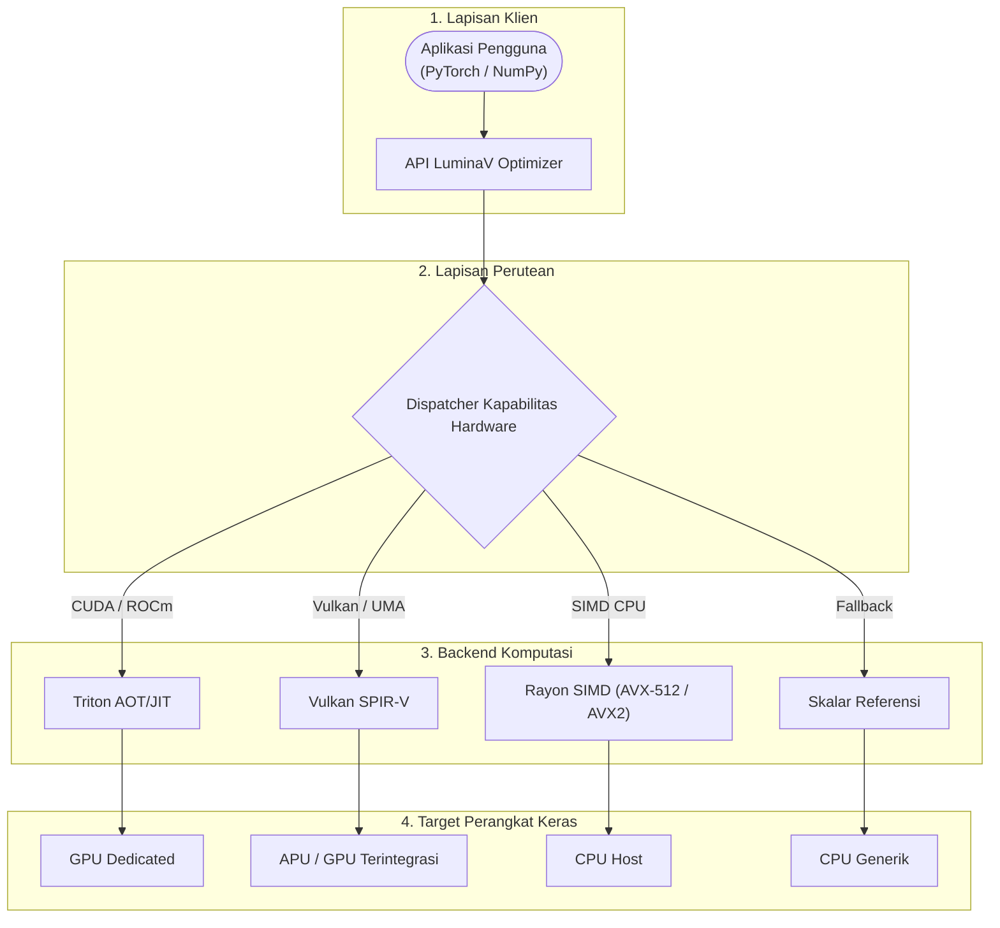

# LuminaV Optimizer v1.0.0

[English Version (README.md)](README.md)

LuminaV adalah mesin optimasi matematika yang mengimplementasikan algoritma LuminaV, dirancang untuk eksekusi numerik presisi rendah secara langsung (BF16/FP16) tanpa mewajibkan master weights FP32. Didukung oleh pembulatan stokastik tingkat-bit (*bitwise stochastic rounding*) yang tidak bias, LuminaV menyediakan akselerasi perangkat keras langsung lintas SIMD CPU (AVX-512, AVX2), compute shader Vulkan, serta kernel GPU Triton, dengan interoperabilitas buffer *zero-copy* untuk NumPy dan PyTorch.

## Fitur

- **Dual-Buffer CLM & Single-Buffer TD-CLM**: Mengimplementasikan Cautious Learning Momentum dengan kompensasi cacat dinamis (*defect compensation*). Mode single-buffer memangkas memori state optimizer sebesar 50%.
- **Bebas Dependensi Wajib**: Paket inti memiliki jejak `dependencies = []` dengan ukuran biner terkompilasi di bawah 1 MB. PyTorch, NumPy, dan Triton bersifat opsional.
- **Akselerasi Perangkat Keras**:
  - **CPU x86_64**: Kernel SIMD AVX-512 dan AVX2 yang diparalelkan lintas inti prosesor via Rayon.
  - **Vulkan 1.3/1.4**: Compute shader SPIR-V dengan Unified Memory Architecture (UMA) untuk GPU terintegrasi maupun diskret.
  - **Triton AOT / JIT**: Kernel terkompilasi ahead-of-time untuk NVIDIA CUDA (SM75–SM120) dan AMD ROCm (RDNA3/CDNA).
  - **Core Skalar**: Jalur cadangan (*fallback*) Rust murni portabel untuk arsitektur lain (ARM/aarch64).
- **Integrasi Framework**:
  - **NumPy 2.x**: Eksekusi *zero-copy* native melalui protokol buffer Python dan `__array_interface__`.
  - **PyTorch**: Antarmuka standar `torch.optim.Optimizer` dengan sinkronisasi kolektif FSDP dan master weights FP16/BF16.
- **Kompatibilitas Runtime**: Dibangun menggunakan CPython Stable ABI (`abi3` dan `abi3t`), mendukung Python 3.10 hingga 3.15+ termasuk eksekusi *free-threaded* (PEP 703).

## Arsitektur & Perutean (Dispatch)

Dispatcher runtime memilih backend eksekusi secara dinamis berdasarkan perangkat tensor, ukuran memori, dan perangkat keras yang tersedia:



## Struktur Crate Workspace

```
optimizer/
├── Cargo.toml
├── src/
│   ├── lib.rs              # Titik masuk crate Rust
│   ├── optimizer.rs        # Implementasi optimizer PyO3 inti
│   └── python_ffi.rs       # Jembatan FFI Python-Rust dan validasi memori
├── crates/
│   ├── luminav-core/       # Formula matematika, PRNG, dan struct status
│   ├── luminav-simd/       # Intrinsik SIMD eksplisit AVX-512 dan AVX2
│   ├── luminav-vulkan/     # Pipeline komputasi Vulkan 1.3/1.4 UMA (Ash)
│   ├── luminav-triton-aot/ # Runner Triton AOT untuk CUDA dan ROCm HIP
│   └── luminav-dispatch/   # Deteksi kapabilitas hardware dan perutean
├── tests/                  # Uji verifikasi mandiri NumPy dan PyTorch
└── tools/                  # Kompiler AOT untuk SPIR-V dan Triton
```

## Instalasi & Kompilasi

### Dari Wheel (PyPI)

```bash
pip install luminamoon
```

### Dari Kode Sumber (Maturin)

```bash
git clone https://github.com/cloverx-id/luminamoon.git
cd luminamoon
pip install maturin
maturin develop --release
```

### Dependensi Ekstra Opsional

```bash
# Integrasi PyTorch
pip install "luminamoon[torch]"

# Akselerasi GPU Triton (CUDA / ROCm)
pip install "luminamoon[gpu]"

# Seluruh dependensi opsional
pip install "luminamoon[all]"
```

## Panduan Cepat

### Standalone NumPy (Tanpa PyTorch)

```python
import numpy as np
from luminamoon import LuminaV

w = np.random.randn(64, 10).astype(np.float32)
b = np.zeros(10, dtype=np.float32)

optimizer = LuminaV(
    [w, b],
    lr=1e-2,
    betas=(0.9, 0.999),
    weight_decay=1e-2,
    buffer=2,  # 2 = Dual-Buffer CLM, 1 = Single-Buffer TD-CLM
)

grad_w = np.random.randn(64, 10).astype(np.float32)
grad_b = np.random.randn(10).astype(np.float32)

optimizer.step(grads=[grad_w, grad_b])
```

### Integrasi PyTorch

```python
import torch
import torch.nn as nn
from luminamoon import LuminaV

device = torch.device("cuda" if torch.cuda.is_available() else "cpu")
model = nn.Sequential(
    nn.Linear(128, 256),
    nn.ReLU(),
    nn.Linear(256, 10),
).to(device)

criterion = nn.CrossEntropyLoss()
optimizer = LuminaV(
    model.parameters(),
    lr=8e-4,
    betas=(0.9, 0.999),
    weight_decay=8e-2,
    buffer=2,
    bound=True,
    bound_type="coordinate",
    cautious=True,
)

inputs = torch.randn(64, 128, device=device)
targets = torch.randint(0, 10, (64,), device=device)

optimizer.zero_grad()
loss = criterion(model(inputs), targets)
loss.backward()
optimizer.step()
```

## Audit Kapabilitas Hardware

Untuk menginspeksi backend perangkat keras yang terdeteksi dan target dispatch aktif:

```python
from luminamoon import LuminaV

print(LuminaV.detect_hardware())
```

## Dokumentasi & Audit Pustaka

- **[Dokumentasi Modular Pengembang (`docs/optimize/README.id.md`)](../docs/optimize/README.id.md)** / **[Versi Inggris (`docs/optimize/README.md`)](../docs/optimize/README.md)**
- **[Dokumentasi Pengguna (`docs/id/README.md`)](../docs/id/README.md)** / **[Versi Inggris (`docs/en/README.md`)](../docs/en/README.md)**
- **[Audit Pustaka Eksternal Optimizer (`docs/library_audit/README.md`)](../docs/library_audit/README.md)**

## Menjalankan Pengujian

```bash
# Analisis lint workspace tanpa peringatan
cargo clippy --workspace --all-targets -- -D warnings

# Uji unit dan keselarasan parity Rust
cargo test --workspace

# Uji mandiri NumPy
python optimizer/tests/test_standalone_numpy.py

# Uji integrasi PyTorch
python optimizer/tests/test_end_to_end_training.py
```

## Lisensi

Dilisensikan di bawah Apache License, Versi 2.0. Lihat [LICENSE](../LICENSE) untuk informasi rinciannya.
