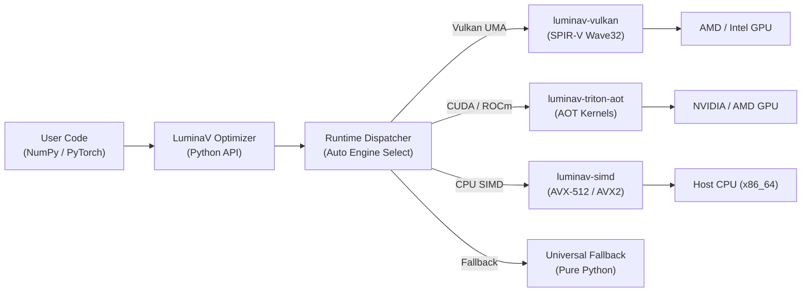

# LuminaV Optimizer v1.0.0

[Versi Bahasa Indonesia (README.id.md)](README.id.md)

LuminaV is a high-performance mathematical optimization engine implementing the LuminaV algorithm, built for direct low-precision execution (BF16/FP16) without requiring FP32 master weights. Powered by unbiased bitwise stochastic rounding, it provides native hardware acceleration across CPU SIMD (AVX-512, AVX2), Vulkan compute shaders, and Triton GPU kernels, with zero-copy buffer interoperability for NumPy and PyTorch.

## Features

- **Dual-Buffer CLM & Single-Buffer TD-CLM**: Implements Cautious Learning Momentum with continuous defect compensation. Single-buffer mode reduces optimizer state memory by 50%.
- **Zero Mandatory Dependencies**: The core package has `dependencies = []` with a compiled binary under 1 MB. PyTorch, NumPy, and Triton are optional.
- **Hardware Acceleration**:
  - **x86_64 CPU**: AVX-512 and AVX2 SIMD kernels parallelized across cores via Rayon.
  - **Vulkan 1.3/1.4**: Unified Memory Architecture (UMA) SPIR-V compute shaders for integrated and discrete GPUs.
  - **Triton AOT / JIT**: Ahead-of-time compiled kernels for NVIDIA CUDA (SM75–SM120) and AMD ROCm (RDNA3/CDNA).
  - **Scalar Core**: Portable pure-Rust fallback for other architectures (ARM/aarch64).
- **Framework Integration**:
  - **NumPy 2.x**: Native zero-copy execution via the Python buffer protocol and `__array_interface__`.
  - **PyTorch**: Standard `torch.optim.Optimizer` interface with FSDP collective synchronization and FP16/BF16 master weights.
- **Runtime Compatibility**: Built with CPython Stable ABI (`abi3` and `abi3t`), supporting Python 3.10 through 3.15+ including free-threaded execution (PEP 703).

## Architecture & Dispatch

The runtime dispatcher automatically selects the execution backend based on tensor device, memory size, and available hardware:



## Workspace Crate Structure

```
optimizer/
├── Cargo.toml
├── src/
│   ├── lib.rs              # Rust crate entry point
│   ├── optimizer.rs        # Core PyO3 optimizer implementation
│   └── python_ffi.rs       # Python-Rust FFI bridge and memory validation
├── crates/
│   ├── luminav-core/       # Mathematical formulas, PRNG, and state structs
│   ├── luminav-simd/       # AVX-512 and AVX2 explicit SIMD intrinsics
│   ├── luminav-vulkan/     # Vulkan 1.3/1.4 UMA compute pipeline (Ash)
│   ├── luminav-triton-aot/ # Triton AOT runner for CUDA and ROCm HIP
│   └── luminav-dispatch/   # Hardware capability detection and routing
├── tests/                  # Standalone NumPy and PyTorch verification tests
└── tools/                  # AOT compilers for SPIR-V and Triton
```

## Installation & Build

### From Wheel (PyPI)

```bash
pip install luminamoon
```

### From Source (Maturin)

```bash
git clone https://github.com/cloverx-id/luminamoon.git
cd luminamoon
pip install maturin
maturin develop --release
```

### Optional Dependencies

```bash
# PyTorch integration
pip install "luminamoon[torch]"

# Triton GPU acceleration (CUDA / ROCm)
pip install "luminamoon[gpu]"

# All optional dependencies
pip install "luminamoon[all]"
```

## Quickstart

### Standalone NumPy (No PyTorch Required)

```python
import numpy as np
from luminamoon import LuminaV

w = np.random.randn(64, 10).astype(np.float32)
b = np.zeros(10, dtype=np.float32)

optimizer = LuminaV(
    [w, b],
    lr=1e-2,
    betas=(0.9, 0.999),
    weight_decay=1e-2,
    buffer=2,  # 2 = Dual-Buffer CLM, 1 = Single-Buffer TD-CLM
)

grad_w = np.random.randn(64, 10).astype(np.float32)
grad_b = np.random.randn(10).astype(np.float32)

optimizer.step(grads=[grad_w, grad_b])
```

### PyTorch Integration

```python
import torch
import torch.nn as nn
from luminamoon import LuminaV

device = torch.device("cuda" if torch.cuda.is_available() else "cpu")
model = nn.Sequential(
    nn.Linear(128, 256),
    nn.ReLU(),
    nn.Linear(256, 10),
).to(device)

criterion = nn.CrossEntropyLoss()
optimizer = LuminaV(
    model.parameters(),
    lr=8e-4,
    betas=(0.9, 0.999),
    weight_decay=8e-2,
    buffer=2,
    bound=True,
    bound_type="coordinate",
    cautious=True,
)

inputs = torch.randn(64, 128, device=device)
targets = torch.randint(0, 10, (64,), device=device)

optimizer.zero_grad()
loss = criterion(model(inputs), targets)
loss.backward()
optimizer.step()
```

## Hardware Verification

To inspect detected hardware backends and active dispatch targets:

```python
from luminamoon import LuminaV

print(LuminaV.detect_hardware())
```

## Documentation & Library Audits

- **[Developer Modular Documentation (`docs/optimize/README.md`)](../docs/optimize/README.md)** / **[Versi Indonesia (`docs/optimize/README.id.md`)](../docs/optimize/README.id.md)**
- **[User Documentation (`docs/en/README.md`)](../docs/en/README.md)** / **[Versi Indonesia (`docs/id/README.md`)](../docs/id/README.md)**
- **[Optimizer External Library Audits (`docs/library_audit/`)](../docs/library_audit/README.md)**

## Running Tests

```bash
# Lint workspace with zero warnings
cargo clippy --workspace --all-targets -- -D warnings

# Rust workspace unit and parity tests
cargo test --workspace

# Standalone NumPy test
python optimizer/tests/test_standalone_numpy.py

# PyTorch integration test
python optimizer/tests/test_end_to_end_training.py
```

## License

Licensed under the Apache License, Version 2.0. See [LICENSE](../LICENSE) for details.

