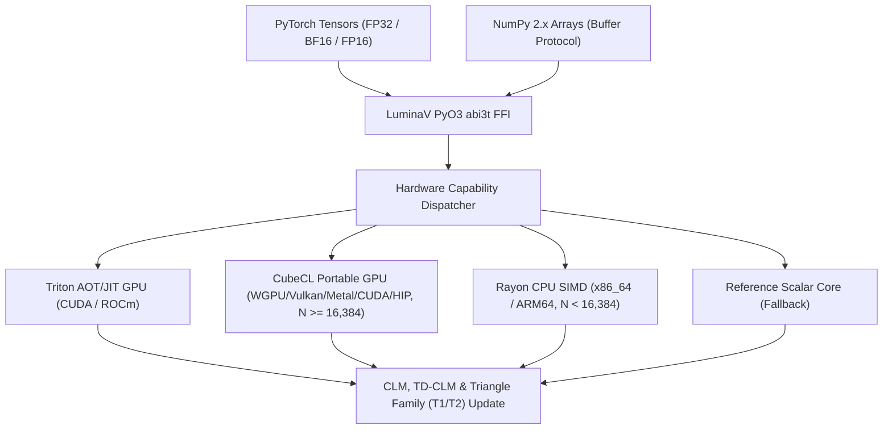

# LuminaV Optimizer v2.0.0 (luminamoon v2.0.0rc1)

LuminaV is a numerical optimization library for low-precision training (BF16/FP16) without requiring FP32 master weights. Using MurmurHash3 + 3D Weyl-Kronecker bitwise stochastic rounding, it supports hardware execution across CPU SIMD (AVX-512, AVX2, ARM64 NEON), CubeCL portable GPU compute (`wgpu`, Vulkan, Metal, CUDA, HIP), and Triton AOT/JIT GPU kernels, with buffer interoperability for NumPy and PyTorch.

## Features

- **Contiguous Bucket Fusion & JIT Pre-Warmup**: Optionally coalesces parameter groups into 1D contiguous allocations (`fuse_tensors=True`) partitioned into bounded chunks (`bucket_cap_mb=500.0`) to reduce kernel launch overhead on models with many tensors, and pre-warms Triton JIT kernels during initialization (`prewarm_jit=True`).
- **Dual-Buffer CLM, Single-Buffer TD-CLM & Triangle Family (T-Family, `T1` / `T2`)**: Implements **Convex Lookahead Momentum (CLM)** (`buffer=2`), **Triangle-Defect Convex Lookahead Momentum (TD-CLM)** (`buffer=1`), and the `tanh`-free **Triangle Family** (`buffer="T2"` 2-Buffer Triangle Family Mode and `buffer="T1"` 1-Buffer Triangle Family Mode with the Triangle Inequality envelope, triangle-defect penalty, and rational update bounds). Single-buffer modes (`1` and `"T1"`) reduce optimizer state memory by 50% compared to two-buffer modes (`2` and `"T2"`).
- **Cautious Weight Decay, RTV & Configurable Bound Floor**: Supports optional `cautious_weight_decay=True`, Rational-Tempered Variance (`variance_type="rtv"`, `variance_temper=3.0`) for 2-buffer modes, and configurable coordinate `bound_floor=1e-2`.
- **Optional Framework Dependencies**: The core package ships with `dependencies = []`; PyTorch, NumPy, and Triton are optional extras.
- **Hardware Acceleration**:
  - **x86_64 & ARM64 CPU**: AVX-512, AVX2+FMA, and ARM64 NEON SIMD kernels parallelized across cores via Rayon.
  - **CubeCL Multi-Backend GPU (optional feature)**: Portable GPU compute kernels (`wgpu`, Vulkan, Metal, CUDA, HIP, CPU) supporting `Dual`, `TdClm`, `T1`, and `T2` optimizer modes plus `luminamoon.nn` ops.
  - **Triton AOT / JIT**: 182 compiled GPU ELF64 binaries (14 kernels across NVIDIA CUDA `sm_75..sm_120` and AMD ROCm `gfx908`, `gfx90a`, `gfx942`, `gfx1100`, `gfx1103`) plus Python Triton JIT kernels.
  - **Scalar Core**: Portable Rust reference fallback for other targets.
- **Framework Integration**:
  - **NumPy 2.x**: Direct buffer access via the Python buffer protocol and `__array_interface__`.
  - **PyTorch**: Standard `torch.optim.Optimizer` interface with FSDP collective synchronization and optional FP16/BF16 master weights.
- **Runtime Compatibility**: Built with CPython Stable ABI (`abi3` and `abi3t`), supporting Python 3.10 through 3.15+ including free-threaded execution (PEP 703).

## Architecture & Dispatch

The runtime dispatcher selects the execution backend based on tensor device, memory size, and available hardware:



## Workspace Crate Structure

```text
optimizer/
├── Cargo.toml
├── src/
│   ├── lib.rs              # Rust crate entry point
│   ├── optimizer.rs        # Rust LuminaVOptimizer struct and batch step orchestration
│   └── python_ffi/         # Python-Rust FFI bridge (mod.rs, config_parser.rs, cubecl_ffi.rs, extract.rs, ra_ffi.rs, worker.rs)
├── crates/
│   ├── luminav-core/       # Mathematical formulas, MurmurHash3 + 3D Weyl-Kronecker PRNG, and state structs
│   ├── luminav-simd/       # AVX-512, AVX2, and ARM64 NEON explicit SIMD intrinsics
│   ├── luminav-cubecl/     # Portable CubeCL GPU compute backend (wgpu, vulkan, metal, cuda, hip, cpu)
│   ├── luminav-triton-aot/ # Triton AOT runner (182 ELF64 binaries) for CUDA and ROCm HIP
│   └── luminav-dispatch/   # Hardware capability detection and routing
├── tests/                  # Standalone NumPy and PyTorch verification tests
└── tools/                  # Triton AOT compiler scripts
```

## Installation & Build

### From Wheel (PyPI)

```bash
pip install --pre luminamoon
```

### From Source (Maturin)

```bash
git clone https://github.com/cloverx-id/luminamoon.git
cd luminamoon
pip install "maturin>=1.15,<2.0"
maturin develop --release
```

### Optional Dependencies

```bash
# PyTorch integration
pip install --pre "luminamoon[torch]"

# Triton GPU acceleration (CUDA / ROCm)
pip install --pre "luminamoon[gpu]"

# Core ML stack (NumPy + PyTorch + Triton GPU)
pip install --pre "luminamoon[all]"
```

## Quickstart

### Standalone NumPy (No PyTorch Required)

```python
import numpy as np
from luminamoon import LuminaV

w = np.random.randn(64, 10).astype(np.float32)
b = np.zeros(10, dtype=np.float32)

optimizer = LuminaV(
    [w, b],
    lr=1e-2,
    betas=(0.9, 0.999),
    weight_decay=1e-2,
    buffer=2,  # 2 = Dual-Buffer CLM, 1 = Single-Buffer TD-CLM
)

grad_w = np.random.randn(64, 10).astype(np.float32)
grad_b = np.random.randn(10).astype(np.float32)

optimizer.step(grads=[grad_w, grad_b])
```

### PyTorch Integration

```python
import torch
import torch.nn as nn
from luminamoon import LuminaV

device = torch.device("cuda" if torch.cuda.is_available() else "cpu")
model = nn.Sequential(
    nn.Linear(128, 256),
    nn.ReLU(),
    nn.Linear(256, 10),
).to(device)

criterion = nn.CrossEntropyLoss()
optimizer = LuminaV(
    model.parameters(),
    lr=3e-4,
    betas=(0.9, 0.999),
    weight_decay=8e-2,
    buffer=2,
    bound=True,
    bound_type="coordinate",
    cautious=True,
    fuse_tensors=False,    # Coalesce parameter groups into contiguous buckets
    bucket_cap_mb=500.0,   # Maximum chunk allocation size in MB
    prewarm_jit=True,      # Pre-compile Triton JIT kernels at initialization
)

inputs = torch.randn(64, 128, device=device)
targets = torch.randint(0, 10, (64,), device=device)

optimizer.zero_grad()
loss = criterion(model(inputs), targets)
loss.backward()
optimizer.step()
```

> **Note on `torch.float16` (`FP16`) Training**: While LuminaV (`v2.0.0`) protects its internal 16-bit optimizer states from underflow using Bitwise-BF16 state promotion (8-bit exponent), the forward pass and `loss.backward()` across external model layers run outside the optimizer boundary. When training language models (Transformers/LLMs) or image/vision models (ViT, CNN, Diffusion) in `torch.float16` (5-bit exponent), enable `torch.amp.GradScaler` so layer-to-layer gradients do not underflow to `0.0` or overflow during `loss.backward()` before reaching `optimizer.step()`. (`torch.bfloat16` already has an 8-bit exponent across the model graph and does not require `GradScaler`).

## Hardware Verification

To inspect detected hardware backends and active dispatch targets:

```python
from luminamoon import LuminaV

print(LuminaV.detect_hardware())
```

## Documentation & Dependency Notes

- **[Developer Modular Documentation (`docs/optimize/README.md`)](../docs/optimize/README.md)**
- **[User Documentation (`docs/en/README.md`)](../docs/en/README.md)**
- **[Workspace Dependency Compatibility Notes (`docs/dependencies/`)](../docs/dependencies/README.md)**

## Running Tests

```bash
# Lint workspace
cargo clippy --workspace --all-targets -- -D warnings

# Rust workspace unit and parity tests
cargo test --workspace

# Python API and parity tests
pytest -q tests/test_optimizer_api_v2.py tests/test_optimizer_parity_v2.py

# Standalone NumPy test
python optimizer/tests/test_standalone_numpy.py

# PyTorch integration test
python optimizer/tests/test_end_to_end_training.py
```

## References

- **Triangle Inequality Defect & Lookahead**: L. Maligranda, "Some remarks on the triangle inequality for norms," *Banach J. Math. Anal.*, vol. 2, no. 2, pp. 31–41, 2008; T. Dozat, "Incorporating Nesterov momentum into Adam," *ICLR Workshop*, pp. 1–4, 2016; M. R. Zhang *et al.*, "Lookahead optimizer: k steps forward, 1 step back," *NeurIPS*, 2019.
- **Belief Variance, Variance Reduction & Decoupled Weight Decay**: J. Zhuang *et al.*, "AdaBelief optimizer: Adapting stepsizes by the belief in observed gradients," *NeurIPS*, 2020; S. Taniguchi *et al.*, "ADOPT: Modified Adam can converge with any β₂ with the optimal rate," *NeurIPS*, 2024; W. Jiang *et al.*, "Adaptive variance reduction for stochastic optimization under weaker assumptions," *NeurIPS*, 2024; I. Loshchilov and F. Hutter, "Decoupled weight decay regularization," *ICLR*, 2019.
- **Cautious Alignment, CWD, Update Bounds & Distributed FSDP**: K. Liang *et al.*, "Cautious optimizers: Improving training with one line of code," *ICLR*, 2026; L. Chen *et al.*, "Cautious weight decay," *ICLR*, 2026 (`arXiv:2510.12402`); A. Brock *et al.*, "High-performance large-scale image recognition without normalization," *ICML*, 2021; T. Dao *et al.*, "FlashAttention: Fast and memory-efficient exact attention with IO-awareness," *NeurIPS*, 2022; Y. Zhao *et al.*, "PyTorch FSDP: Experiences on scaling fully sharded data parallel," *PVLDB*, 2023; W. Liang *et al.*, "TorchTitan: One-stop PyTorch native solution for production ready LLM pre-training," *ICLR*, 2025.
- **Padé Rational Approximants & Stochastic Rounding**: A. Molina *et al.*, "Padé activation units: End-to-end learning of flexible activation functions in deep networks," *ICLR*, 2020; S. Gupta *et al.*, "Deep learning with limited numerical precision," *ICML*, 2015; P. Zamirai *et al.*, "Revisiting BFloat16 training," *arXiv:2010.06192*, 2021; T. Yu *et al.*, "COLLAGE: Light-weight low-precision strategy for LLM training," *ICML*, 2024; K. Ozkara *et al.*, "Stochastic rounding for LLM training: Theory and practice," *AISTATS*, 2025.

## License

Licensed under the Apache License, Version 2.0. See [LICENSE](../LICENSE) for details.
